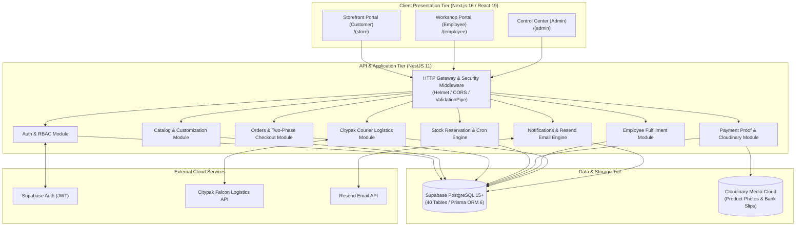
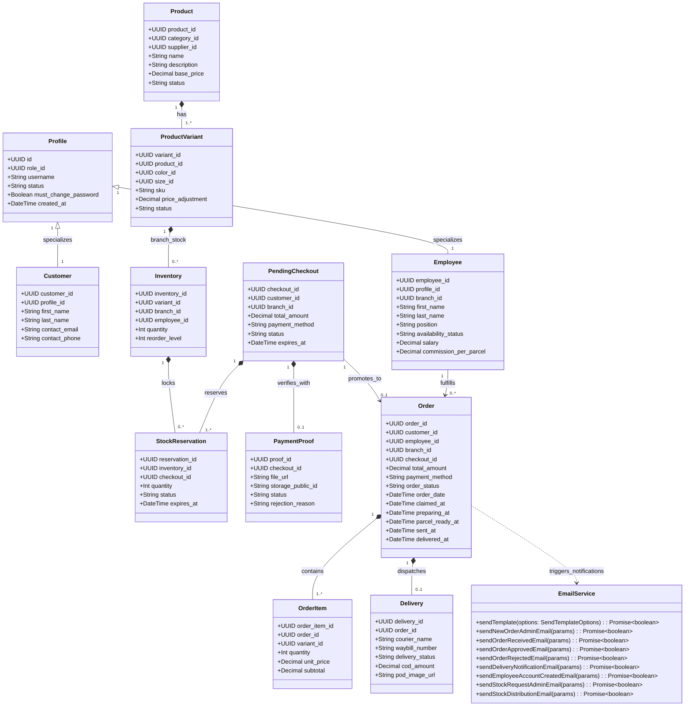
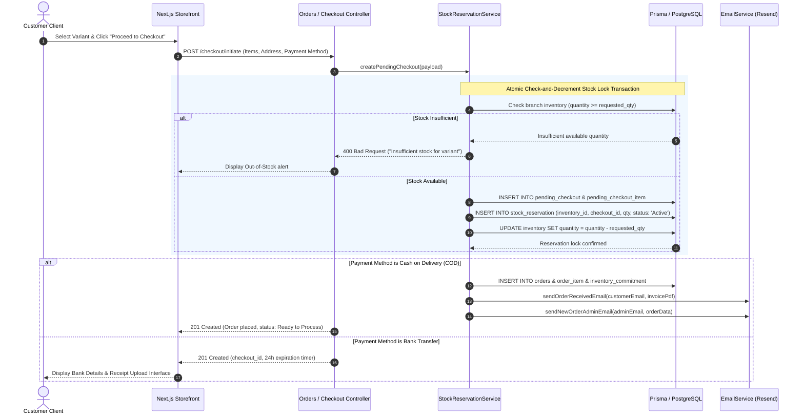
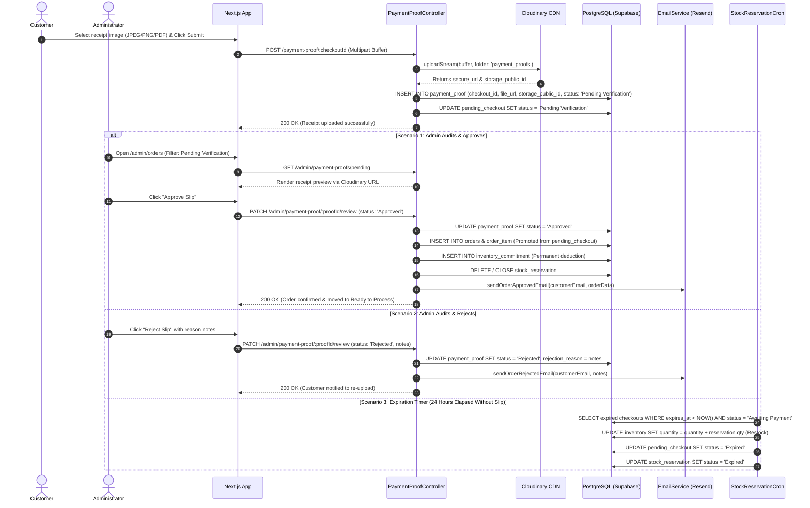
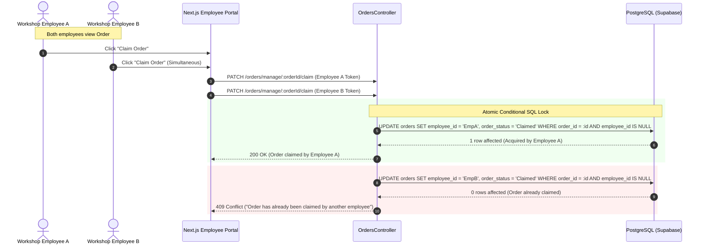

# Vergo Wear - Developer Documentation

**Course:** Team Software Project (CSC304S3 / CSC304G3)  
**Department:** Department of Computer Science, Faculty of Science, University of Jaffna  
**Project Title:** Vergo Wear - Custom Apparel & E-Commerce Order Management Platform  
**Submission Date:** November 2026  
**Document Version:** 2.0.0 (Production Release)  

---

## Table of Contents

1. [Title Page](#1-title-page)
2. [Introduction](#2-introduction)
   - 2.1 [Brief About the Software](#21-brief-about-the-software)
   - 2.2 [Objectives of the Software & Intended Impact](#22-objectives-of-the-software--intended-impact)
   - 2.3 [Challenges Addressed via this Software](#23-challenges-addressed-via-this-software)
3. [System Architecture Overview](#3-system-architecture-overview)
   - 3.1 [High-Level Architecture](#31-high-level-architecture)
   - 3.2 [Core Functionalities of Key Components](#32-core-functionalities-of-key-components)
4. [Diagrams](#4-diagrams)
   - 4.1 [Use Case Diagram](#41-use-case-diagram)
   - 4.2 [Entity Relationship (ER) Diagram](#42-entity-relationship-er-diagram)
   - 4.3 [Class Diagram](#43-class-diagram)
   - 4.4 [Sequence Diagrams for Critical Processes](#44-sequence-diagrams-for-critical-processes)
     - Sequence Diagram A: Two-Phase Checkout & Concurrency-Safe Stock Reservation
     - Sequence Diagram B: Bank Slip Upload, Cloudinary CDN & Admin Audit Verification
     - Sequence Diagram C: Workshop Employee Order Claiming & Concurrency Lock
5. [Development Setup and Installation](#5-development-setup-and-installation)
   - 5.1 [Development Environment Setup & Prerequisites](#51-development-environment-setup--prerequisites)
   - 5.2 [Installing Dependencies](#52-installing-dependencies)
   - 5.3 [Environment Variables Configuration](#53-environment-variables-configuration)
   - 5.4 [Building and Running the Project from Source](#54-building-and-running-the-project-from-source)
6. [Testing Overview](#6-testing-overview)
   - 6.1 [Testing Strategy & Frameworks](#61-testing-strategy--frameworks)
   - 6.2 [Automated Unit & Integration Test Suites (Jest)](#62-automated-unit--integration-test-suites-jest)
   - 6.3 [Manual & End-to-End Test Cases Matrix](#63-manual--end-to-end-test-cases-matrix)
7. [Future Development and Known Issues](#7-future-development-and-known-issues)
   - 7.1 [Known Issues and Limitations](#71-known-issues-and-limitations)
   - 7.2 [Recommended Improvements for Future Iterations](#72-recommended-improvements-for-future-iterations)
8. [Team Details and Project Link](#8-team-details-and-project-link)
   - 8.1 [Team Members Details & Assigned Roles](#81-team-members-details--assigned-roles)
   - 8.2 [GitHub Project Repository](#82-github-project-repository)

---

## 1. Title Page

```
========================================================================================
                         UNIVERSITY OF JAFFNA, SRI LANKA
                               FACULTY OF SCIENCE
                        DEPARTMENT OF COMPUTER SCIENCE

                     TEAM SOFTWARE PROJECT (CSC304S3 / CSC304G3)
                             DEVELOPER DOCUMENTATION

                                   VERGO WEAR
               Custom Apparel E-Commerce & Order Management Platform

                                 Version: 2.0.0
                            Submission Date: November 2026
========================================================================================
```

### Copyright & Intellectual Property Statement

```
Copyright (c) 2026 Vergo Wear Development Team.
Department of Computer Science, Faculty of Science, University of Jaffna.

All rights reserved.

This software, source code, design models, documentation, and graphical assets are 
the intellectual property of the Vergo Wear Team for the course module 
"Team Software Project (CSC304S3 / CSC304G3)". 

Permission is hereby granted, free of charge, to course coordinators, instructors, 
supervisors, reviewers, and authorized stakeholders to inspect, test, compile, and run 
the software. 

Redistribution, reproduction, commercial exploitation, or unauthorized modification of 
any part of this codebase without prior written authorization from the authors or the 
client (Vergo Wear) is strictly prohibited.
```

---

## 2. Introduction

### 2.1 Brief About the Software

**Vergo Wear** is a full-stack, enterprise-grade custom order management and e-commerce web platform engineered specifically for modern custom apparel brands. While standard off-the-shelf e-commerce platforms accommodate generic retail products, apparel enterprises face intricate operational challenges: multi-attribute variant customization (size, color, print/embroidery placement), localized multi-branch inventory tracking, multi-stage workshop order preparation, dual payment reconciliation (Cash on Delivery and direct bank transfer slips requiring administrative verification), and automated courier parcel dispatch via third-party logistics APIs.

The system is constructed with a modern dual-tier decoupled architecture:
- **Frontend Client Application:** Built with **Next.js 16 (App Router)** and **React 19**, styled using **Tailwind CSS 4**, featuring dedicated workspaces for Storefront Customers, Workshop Floor Employees, and Executive Store Administrators.
- **Backend Application Service:** Powered by **NestJS 11** with TypeScript, following modular domain design, dependency injection, and declarative validation pipes.
- **Data & Security Tier:** Leverages **Supabase PostgreSQL 15+** with **Prisma ORM 6.2.0**, hardened with Row Level Security (RLS) policies, atomic stock reservations, cryptographic JWT validation, and in-memory buffer uploads directly to **Cloudinary Media CDN**.
- **Logistics & Notifications:** Integrated with the **Citypak Falcon Client API v0.2.5** for thermal Code 128 barcode waybill generation and real-time tracking, coupled with the **Resend API SDK** for transactional customer and staff notifications.

### 2.2 Objectives of the Software & Intended Impact

The primary quantifiable business and technical objectives of the Vergo Wear platform are:

1. **Deliver an Intuitive, High-Converting Apparel Storefront:** Enable shoppers across mobile, tablet, and desktop devices to browse apparel collections, apply real-time multi-criteria filters (category, size, color swatch, price range), configure custom garment prints, and complete checkout within minutes.
2. **Prevent Overselling with Concurrency-Safe Stock Reservation:** Implement atomic check-and-decrement database locks that temporarily isolate inventory during checkout, eliminating flash-drop race conditions and duplicate orders.
3. **Digitize Direct Bank Transfer Verification:** Eliminate manual receipt handling via social media messaging apps by providing an authenticated slip upload workflow backed by an automated 24-hour expiration cron engine that releases stock if unverified.
4. **Optimize Workshop Floor Fulfillment:** Provide workshop employees with a dedicated live fulfillment queue featuring conditional SQL atomic order claiming locks to prevent duplicate packaging, alongside read-only protection on sensitive billing data.
5. **Streamline End-to-End Courier Logistics:** Automate parcel registration with Citypak Couriers, generate thermal 4x6 Code 128 barcode waybills on-demand, process HMAC-SHA256 signature-verified status webhooks, and trigger automated delivery emails upon parcel handover.
6. **Empower Executive Decision-Making:** Consolidate real-time sales metrics, profit margins, branch inventory reorder alerts, staff commission balances, and customer review moderation into a single dashboard.

### 2.3 Challenges Addressed via this Software

Prior to the deployment of the Vergo Wear platform, custom apparel retail operations suffered from several critical operational bottlenecks:

| Operational Challenge | Real-World Impact | How Vergo Wear Solves It |
| :--- | :--- | :--- |
| **Inventory Discrepancy & Overselling** | Shared inventory between physical branches and online orders caused customers to purchase items already sold off the shelf. | Real-time multi-branch inventory management with atomic database reservation locks in `stock_reservation`. |
| **Manual Bank Slip Reconciliation** | Over 50% of transactions occur via bank deposit; reconciling WhatsApp/email screenshots against bank statements took 24–48 hours. | Secure upload via Cloudinary, dedicated admin audit modal for 1-click approvals, and automated 24-hour expiration timers. |
| **Customer Support Inundation** | Support staff spent hours answering repetitive queries regarding order preparation and parcel whereabouts. | Self-service tracking portal with visual milestone steppers and real-time status updates synced with Citypak webhooks. |
| **Disorganized Workshop Floor Packing** | Lack of digital coordination caused multiple floor workers to package the same order or lose track of custom embroidery notes. | Real-time order claiming queue with conditional SQL locks (`WHERE employee_id IS NULL`), tamper-proof prep screens, and clear checklists. |
| **Geographic Shipping Discrepancies** | Variable courier delivery charges across Sri Lanka's 25 administrative districts caused revenue loss from flat-rate shipping. | Dynamic district-based fee calculation engine querying the `delivery_fee_rules` database table at checkout. |

---

## 3. System Architecture Overview

### 3.1 High-Level Architecture

Vergo Wear follows a decoupled, cloud-native 3-tier architecture:



### 3.2 Core Functionalities of Key Components

The system is organized into modular backend components and frontend portals:

#### 1. Customer Storefront & Catalog Engine (`product-catalogue`, `customization`, `cart`)
- **Product Catalog:** Real-time multi-criteria filtering by category, size, color, and price.
- **Dynamic Variant Pricing:** Computes variant retail prices on the fly (`base_price + price_adjustment`).
- **Shopping Cart:** Persistent database cart for authenticated users; session-backed local cart for guests.
- **Apparel Customization:** Garment print/embroidery placement selection with instant mockup preview.

#### 2. Two-Phase Checkout & Concurrency-Safe Stock Reservation (`orders`, `stock-reservation`)
- **District Delivery Rates:** Computes exact shipping fees for Sri Lanka's 25 administrative districts.
- **Atomic Stock Reservation:** Check-and-decrement locking pattern in `stock_reservation` preventing race conditions during flash sales.
- **Dual Payment Rails:** Direct Cash on Delivery (COD) confirmation and Bank Transfer slip upload flow.
- **Automated Expiration Cron:** Background cron worker running every 30 minutes to release unverified inventory after 24 hours.

#### 3. Bank Slip Audit & Media Processing (`payment-proof`, `cloudinary`)
- **In-Memory Streaming:** Deposit slips upload directly from memory buffers to Cloudinary CDN without touching server disk.
- **Administrative Audit Modal:** One-click approval/rejection with custom audit reason notes.
- **Post-Rejection Cleanup:** Automated Cloudinary asset invalidation upon slip replacement or order cancellation.

#### 4. Workshop Fulfillment & Commission Management (`employees`, `orders`)
- **Zero-Collision Order Claiming:** Atomic conditional update locks (`UPDATE orders SET employee_id = ... WHERE employee_id IS NULL`) prevent concurrent claiming by multiple employees.
- **Tamper-Proof Preparation GUI:** Sensitive payment method and COD collection amount inputs are strictly locked and read-only.
- **Personal Stock Management:** Paginated, collection- and size-filterable inventory dashboard with interactive stock request triggers.
- **Commission Ledger:** Tracks earned packaging commissions per employee with branch payroll balance auditing.

#### 5. Citypak Courier Logistics Integration (`integrations/citypak`)
- **Consignment Registration:** Automatic parcel registration with COD amount, weight, and package dimensions.
- **Thermal Barcode Waybills:** Direct streaming of printer-ready thermal Code 128 barcode waybills (`4X6` adhesive labels & `A4` manifests).
- **Courier Handover ("Pickedup Citypak"):** Single-click action transitioning parcel to `Handed to Courier`, triggering automated customer email notifications and UI button fading to prevent double submissions.
- **Signature-Verified Webhooks:** Inbound webhook listener verifying `X-Citypak-Signature` with HMAC-SHA256.

#### 6. Transactional Email Engine (`email`, `notifications`)
- **Official Resend API Integration:** Dispatches dynamic branded emails using published template identifiers:
  - `new-order-notification`: Alerts store administrators of incoming orders.
  - `order-received-waiting-for-admin-approval`: Sends order confirmation and PDF invoice to customer.
  - `order-approved`: Notifies customer upon payment slip verification.
  - `order-rejection`: Informs customer of payment slip rejection with feedback notes.
  - `delivery-notification`: Alerts customer when parcel is handed to Citypak courier with tracking code.
  - `employee-account-creation`: Delivers login credentials and temporary password to new staff.
  - `stock-request`: Notifies store administration of employee restock requests.
  - `stock-distribution`: Alerts employees of central stock allocations to their branch.
- **Strict Parameter Sanitization:** Automatically casts all template variable values to string primitives (`String(value)`), preventing Resend validation errors.
- **Non-Blocking Fault Isolation:** Failed email dispatches are logged as warnings and never roll back successful database transactions.

---

## 4. Diagrams

### 4.1 Use Case Diagram

The following Use Case Diagram illustrates the system interactions from the perspectives of the four primary system actors:

```mermaid
flowchart TD
    subgraph Actors
        C((Customer))
        E((Employee))
        A((Administrator))
        L((Logistics Courier))
    end

    subgraph StorefrontPortal["Storefront & Account Portal"]
        UC1[Browse Catalog & Filter Variants]
        UC2[Configure Apparel Customization]
        UC3[Manage Shopping Cart]
        UC4[Checkout & Select District Shipping]
        UC5[Upload Bank Deposit Slip]
        UC6[Track Parcel Delivery Status]
        UC7[Submit Verified Garment Review]
    end

    subgraph FulfillmentPortal["Workshop Fulfillment Portal"]
        UC8[View Unclaimed Order Queue]
        UC9[Claim Order for Packaging]
        UC10[Inspect Prep Checklist & Garment Specs]
        UC11[Manage Personal Stock & Request Restock]
        UC12[Print Thermal Waybills & Invoices]
        UC13[Dispatch Handover via Pickedup Citypak]
    end

    subgraph AdminPortal["Administrative Control Center"]
        UC14[Audit & Approve/Reject Payment Slips]
        UC15[Distribute Stock to Employees]
        UC16[Create Products & Generate Variant SKUs]
        UC17[View Revenue KPIs & Sales Analytics]
        UC18[Manage Staff Commissions & Payroll]
        UC19[Moderate Customer Reviews]
    end

    subgraph ExternalLogistics["External Integrations"]
        UC20[Stream Code 128 Barcode Waybills]
        UC21[Inbound Tracking Webhooks]
        UC22[Resend Transactional Email Dispatch]
    end

    C --> UC1
    C --> UC2
    C --> UC3
    C --> UC4
    C --> UC5
    C --> UC6
    C --> UC7

    E --> UC8
    E --> UC9
    E --> UC10
    E --> UC11
    E --> UC12
    E --> UC13

    A --> UC14
    A --> UC15
    A --> UC16
    A --> UC17
    A --> UC18
    A --> UC19

    L --> UC21
    UC12 --> UC20
    UC4 --> UC22
    UC14 --> UC22
    UC13 --> UC22
    UC11 --> UC22
    UC15 --> UC22
```



### 4.2 Entity Relationship (ER) Diagram

The data structure comprises 40 relational PostgreSQL tables enforcing referential integrity across identity, catalog, two-phase checkout, logistics, and review domains:

```mermaid
erDiagram
    ROLE ||--o{ PROFILES : "has"
    PROFILES ||--o| EMPLOYEE : "1:1 profile"
    PROFILES ||--o| CUSTOMER : "1:1 profile"
    BRANCH ||--o{ EMPLOYEE : "employs"
    EMPLOYEE ||--o{ ATTENDANCE : "logs"
    EMPLOYEE ||--o{ EMPLOYEE_COMMISSION : "earns"
    
    CATEGORY ||--o{ PRODUCT : "classifies"
    SUPPLIER ||--o{ PRODUCT : "supplies"
    PRODUCT ||--|{ PRODUCT_VARIANT : "has"
    COLOR ||--o{ PRODUCT_VARIANT : "colors"
    SIZE ||--o{ PRODUCT_VARIANT : "sizes"
    PRODUCT_VARIANT ||--o{ IMAGES : "photographs"
    
    PRODUCT_VARIANT ||--o{ INVENTORY : "stocked_in"
    BRANCH ||--o{ INVENTORY : "stores"
    EMPLOYEE ||--o{ INVENTORY : "holds_personal_stock"
    
    CUSTOMER ||--o| CART : "owns"
    CART ||--|{ CART_ITEM : "contains"
    PRODUCT_VARIANT ||--o{ CART_ITEM : "chosen_in"
    
    CUSTOMER ||--o{ PENDING_CHECKOUT : "initiates"
    PENDING_CHECKOUT ||--|{ PENDING_CHECKOUT_ITEM : "contains"
    PENDING_CHECKOUT ||--|| PENDING_CHECKOUT_CUSTOMER_DETAILS : "1:1 snapshot"
    PENDING_CHECKOUT ||--|| PENDING_CHECKOUT_SHIPPING_DETAILS : "1:1 snapshot"
    INVENTORY ||--o{ STOCK_RESERVATION : "reserves"
    PENDING_CHECKOUT ||--o{ STOCK_RESERVATION : "holds"
    PENDING_CHECKOUT ||--o| PAYMENT_PROOF : "verifies_with"
    
    PENDING_CHECKOUT ||--o| ORDERS : "promotes_to"
    CUSTOMER ||--o{ ORDERS : "places"
    EMPLOYEE ||--o{ ORDERS : "fulfills"
    BRANCH ||--o{ ORDERS : "originates_from"
    ORDERS ||--|{ ORDER_ITEM : "contains"
    ORDERS ||--|| ORDER_CUSTOMER_DETAILS : "1:1 immutable"
    ORDERS ||--|| ORDER_SHIPPING_DETAILS : "1:1 immutable"
    
    INVENTORY ||--o{ INVENTORY_COMMITMENT : "deducts"
    ORDER_ITEM ||--o| INVENTORY_COMMITMENT : "binds_to"
    
    ORDERS ||--o| DELIVERY : "dispatches"
    EMPLOYEE ||--o{ DELIVERY : "submits"
    DELIVERY ||--o{ DELIVERY_WAYBILL : "tracks"
    DELIVERY ||--o{ DELIVERY_TRACKING_EVENT : "logs"
    DELIVERY ||--o{ COURIER_PICKUP_DELIVERY : "grouped_in"
    BRANCH ||--o{ COURIER_SHIPPER_PROFILE : "configures"
    COURIER_SHIPPER_PROFILE ||--o{ COURIER_PICKUP_REQUEST : "schedules"
    COURIER_PICKUP_REQUEST ||--o{ COURIER_PICKUP_DELIVERY : "batches"
    
    CUSTOMER ||--o{ REVIEW : "writes"
    PRODUCT ||--o{ REVIEW : "reviewed_in"
    ORDER_ITEM ||--o| REVIEW : "verified_by"
    REVIEW ||--o{ REVIEW_IMAGE : "displays"
    
    CUSTOMER ||--o{ USER_ADDRESSES : "saves"
    ORDERS ||--o{ NOTIFICATION : "triggers"
    PENDING_CHECKOUT ||--o{ NOTIFICATION : "alerts"
```



### 4.3 Class Diagram

The class diagram below depicts the primary NestJS domain service providers, data transfer objects, and entities:



### 4.4 Sequence Diagrams for Critical Processes

#### Sequence Diagram A: Two-Phase Checkout & Concurrency-Safe Stock Reservation



#### Sequence Diagram B: Bank Slip Upload, Cloudinary CDN & Admin Audit Verification



#### Sequence Diagram C: Workshop Employee Order Claiming & Concurrency Lock



---

## 5. Development Setup and Installation

### 5.1 Development Environment Setup & Prerequisites

Before running the Vergo Wear system, verify that your local workstation meets the following prerequisites:

- **Operating System:** Windows 10/11, macOS Monterey+, or Ubuntu Linux 22.04+ LTS.
- **Node.js:** `v20.x` or `v22.x` LTS (`node -v`).
- **Package Manager:** `npm` v10+ (`npm -v`).
- **Version Control:** `Git` 2.40+ (`git --version`).
- **Cloud Accounts Required:**
  - **Supabase Account:** Free or Pro project for PostgreSQL 15+ database and Supabase Auth.
  - **Cloudinary Account:** Free media storage plan for product photography and bank deposit slips.
  - **Resend Account:** API key with verified sending domain for transactional emails.
  - **Citypak Developer Account:** Staging credentials for the Falcon Courier Client API.

### 5.2 Installing Dependencies

Clone the official repository and install the dependencies for both services:

```bash
# 1. Clone the project repository
git clone https://github.com/Vergo-Wear/vergo-app.git
cd vergo-app

# 2. Install backend dependencies
cd backend
npm install

# 3. Install frontend dependencies
cd ../frontend
npm install
```

### 5.3 Environment Variables Configuration

#### A. Backend Configuration (`backend/.env`)
Copy the sample environment template and fill in your cloud credentials:

```bash
cd backend
cp .env.example .env
```

Configure `.env` with the following keys:

```ini
PORT=3001
FRONTEND_URL=http://localhost:3000

# Supabase PostgreSQL Database (Session Pooler port 5432)
DATABASE_URL="postgresql://postgres.[PROJECT-REF]:[YOUR-PASSWORD]@[POOLER-HOST]:5432/postgres"
DIRECT_URL="postgresql://postgres.[PROJECT-REF]:[YOUR-PASSWORD]@[POOLER-HOST]:5432/postgres"
DATABASE_POOL_MAX=5
DATABASE_CONNECTION_TIMEOUT_MS=15000
DATABASE_TRANSACTION_MAX_WAIT_MS=10000
DATABASE_TRANSACTION_TIMEOUT_MS=20000

# Supabase Authentication
SUPABASE_URL=https://[YOUR-PROJECT-REF].supabase.co
SUPABASE_ANON_KEY=eyJhbGciOi...
SUPABASE_SERVICE_ROLE_KEY=eyJhbGciOi...

# Cloudinary Media CDN
CLOUDINARY_CLOUD_NAME=your_cloud_name
CLOUDINARY_API_KEY=your_api_key
CLOUDINARY_API_SECRET=your_api_secret

# Resend Transactional Email API
RESEND_API_KEY=re_xxxxxxxxxxxxxx
RESEND_FROM_EMAIL="Vergo Wear <orders@vergowear.com>"
RESEND_ADMIN_FROM_EMAIL="Vergo Admin <admin@vergowear.com>"
VERGO_ADMIN_EMAIL=admin@vergowear.com
RESEND_TEMPLATE_NEW_ORDER=new-order-notification
RESEND_TEMPLATE_ORDER_RECEIVED=order-received-waiting-for-admin-approval
RESEND_TEMPLATE_ORDER_APPROVED=order-approved
RESEND_TEMPLATE_ORDER_REJECTED=order-rejection
RESEND_TEMPLATE_DELIVERY=delivery-notification
RESEND_TEMPLATE_EMPLOYEE=employee-account-creation
RESEND_TEMPLATE_STOCK_REQUEST=stock-request
RESEND_TEMPLATE_STOCK_DISTRIBUTION=stock-distribution

# Citypak Falcon Courier Integration
CITYPAK_BASE_URL=https://staging.citypak.lk
CITYPAK_API_TOKEN=your_citypak_api_token
CITYPAK_WEBHOOK_SECRET=your_citypak_webhook_secret
```

#### B. Frontend Configuration (`frontend/.env.local`)
Create a `.env.local` file inside the `frontend/` directory:

```ini
NEXT_PUBLIC_API_URL=http://localhost:3001
NEXT_PUBLIC_SUPABASE_URL=https://[YOUR-PROJECT-REF].supabase.co
NEXT_PUBLIC_SUPABASE_ANON_KEY=eyJhbGciOi...
```

### 5.4 Building and Running the Project from Source

#### 1. Generate Prisma Client
Inside the `backend/` directory, run:
```bash
npx prisma generate
```

#### 2. Run Backend in Development Mode
```bash
npm run start:dev
```
The NestJS API gateway will bootstrap and listen on `http://localhost:3001`.

#### 3. Run Frontend in Development Mode
In a separate terminal:
```bash
cd frontend
npm run dev
```
The Next.js storefront client will be accessible at `http://localhost:3000`.

#### 4. Compiling and Building for Production
```bash
# Build Backend
cd backend
npm run build
npm run start:prod

# Build Frontend
cd ../frontend
npm run build
npm run start
```

---

## 6. Testing Overview

### 6.1 Testing Strategy & Frameworks

Vergo Wear adheres to standard software engineering quality assurance protocols:
- **Testing Frameworks:** **Jest 29+**, **Supertest**, and **TypeScript Compiler (`tsc`)**.
- **Pyramid Distribution:**
  - **Unit Testing (Automated):** Isolated Jest unit tests testing service providers, DTO transformers, and pricing arithmetic with mock dependencies.
  - **Integration Testing (Automated):** Validates controller-service pipelines, database transactions, and error filter handling.
  - **Type Safety Validation:** Strict zero-error TypeScript validation (`tsc --noEmit`).
  - **Manual End-to-End Testing:** Structured test matrix verifying user journeys across Customer, Employee, and Admin portals.

### 6.2 Automated Unit & Integration Test Suites (Jest)

The backend includes 14 automated spec test suites:

| Spec Suite File | Target Module | Scope & Critical Assertions |
| :--- | :--- | :--- |
| `auth.spec.ts` | `AuthService` | User signup, password strength checks, JWT issuance, RBAC extraction. |
| `orders.service.spec.ts` | `OrdersService` | Order placement, immutable snapshot creation, status transitions. |
| `stock-reservation.service.spec.ts` | `StockReservationService` | Concurrency check-and-lock, 24-hour expiration restock cron. |
| `payment-proof.service.spec.ts` | `PaymentProofService` | Slip buffer upload, Cloudinary public ID storage, approval/rejection audit. |
| `delivery-fees.service.spec.ts` | `DeliveryFeesService` | District rule resolution, fallback rates, free shipping thresholds. |
| `employees.service.spec.ts` | `EmployeesService` | Conditional SQL order claiming lock, commission ledger mathematics. |
| `admin.service.spec.ts` | `AdminService` | Revenue aggregation, stock distribution to employees, low-stock alerts. |
| `notifications.service.spec.ts` | `NotificationsService` | Resend API template compilation, string parameter sanitization, delivery dispatch. |
| `product-catalogue.service.spec.ts` | `ProductCatalogueService` | Category/size/color filtering, dynamic variant price calculations. |
| `cart.service.spec.ts` | `CartService` | User persistent cart operations, quantity updates, total computation. |
| `reviews.service.spec.ts` | `ReviewsService` | Verified buyer verification, 1-5 star ratings math, moderation filters. |
| `addresses.service.spec.ts` | `AddressesService` | Address book insertion, single-primary address partial unique index check. |
| `user-role.spec.ts` | `UserRoleService` | Role extraction and guard decorator validation. |
| `app.controller.spec.ts` | `AppController` | API health check, service uptime, and version endpoints. |

#### Running Automated Tests
```bash
# Run all 14 unit test suites
cd backend
npm run test

# Run tests with code coverage analysis
npm run test:cov

# Run frontend TypeScript type verification
cd ../frontend
npm run typecheck
```

### 6.3 Manual & End-to-End Test Cases Matrix

| Test ID | Test Scenario | Preconditions | Execution Steps | Expected Result | Status |
| :--- | :--- | :--- | :--- | :--- | :--- |
| **TC-01** | Customer Registration & Strong Password | Registration page open | 1. Enter email, phone, and strong password<br>2. Submit form | Account created in Supabase Auth & `profiles`; confirmation displayed. | **PASS** |
| **TC-02** | Weak Password Validation | Registration page open | 1. Enter password `123`<br>2. Submit form | Validation error: Requires 8+ chars, 1 number, 1 symbol. | **PASS** |
| **TC-03** | Dynamic Variant Price Update | Product has adjustment | 1. Open hoodie page<br>2. Switch size to XXL (+Rs. 300) | Price updates dynamically from Rs. 7,500 to Rs. 7,800. | **PASS** |
| **TC-04** | Out-of-Stock Badge Enforcement | Variant inventory = 0 | 1. Select zero-stock variant | "Add to Cart" button disabled with "Sold Out" badge. | **PASS** |
| **TC-05** | District Delivery Fee Resolution | Items in cart | 1. Select "Jaffna" (Rs. 450)<br>2. Change to "Colombo" (Rs. 300) | Delivery fee and order total recalculate instantly. | **PASS** |
| **TC-06** | Atomic Stock Reservation Lock | 2 units in stock | 1. Complete Bank Transfer checkout for 2 units | Available quantity decreases to 0; `reserved_quantity` increases to 2. | **PASS** |
| **TC-07** | Concurrent Checkout Prevention | 1 unit in stock | 1. Two buyers click checkout simultaneously | First buyer acquires lock; second buyer receives "Insufficient Stock". | **PASS** |
| **TC-08** | Bank Slip Cloudinary Upload | Order in Pending Payment | 1. Upload valid receipt JPEG<br>2. Submit | Slip stored on Cloudinary; order moves to `Pending Verification`. | **PASS** |
| **TC-09** | Slip Expiration & Auto-Restock | 24 hours unverified | 1. Run expiration cron | Checkout marked `Expired`; reserved stock restored to available quantity. | **PASS** |
| **TC-10** | Admin Payment Slip Approval | Slip in Pending Verification | 1. Admin clicks "Approve" in modal | Order status moves to `Admin Approved`; Resend approval email dispatched. | **PASS** |
| **TC-11** | Employee Order Claiming Lock | Order in Ready to Process | 1. Employee A clicks "Claim Order"<br>2. Employee B clicks simultaneously | Order locked to Employee A; Employee B receives 409 Conflict. | **PASS** |
| **TC-12** | Product Prep Tamper Protection | Order claimed | 1. Open `/employee/product-prep`<br>2. Attempt to edit COD or Payment Type | Input fields are disabled and read-only; editing is completely blocked. | **PASS** |
| **TC-13** | Personal Stock Pagination & Filters | Staff logged in | 1. Open `/employee/stock`<br>2. Filter by Collection "Men" and Size "L" | Table scroll-height contained; pagination updates; records filter cleanly. | **PASS** |
| **TC-14** | Stock Restock Request Email | Low inventory | 1. Submit "Request Stock" modal | Resend template `stock-request` delivered to admin with string sanitized args. | **PASS** |
| **TC-15** | Courier Handover & Delivery Email | Order in Ready status | 1. Click "Pickedup Citypak" button | Status updates to `Handed to Courier`; button fades; Resend delivery email sent. | **PASS** |
| **TC-16** | Thermal Waybill 4x6 Streaming | Parcel registered | 1. Click "Print Waybill" | Thermal Code 128 barcode waybill (4x6 PDF) streams directly for printing. | **PASS** |
| **TC-17** | Admin Stock Distribution | Central stock available | 1. Distribute 10 units to Employee in `/admin/inventory` | Inventory balances update; Resend `stock-distribution` email sent to staff. | **PASS** |

---

## 7. Future Development and Known Issues

### 7.1 Known Issues and Limitations

1. **Guest Cart Session Bound:** Guest shopping cart items are held in browser `sessionStorage`. If an unauthenticated guest clears browser cookies or closes the browser window completely without signing in, their temporary selections are cleared.
2. **Barcode Scanner Direct Webhook API:** Workshop staff currently enter or verify garment SKUs visually through the web UI; direct hardware Bluetooth Code 128 scanner wedge integration is planned for the next release.
3. **Courier API Fallback Mock Mode:** In staging environments where Citypak test sandbox servers experience third-party downtime, the courier service operates in sandbox simulation mode to prevent developer blocking.

### 7.2 Recommended Improvements for Future Iterations

1. **Interactive 3D WebGL Garment Customizer:** Transition from 2D SVG canvas preview to interactive 3D WebGL/Three.js garment models allowing 360-degree rotation and realistic fabric texture rendering.
2. **Automated Optical Character Recognition (OCR) for Bank Slips:** Integrate an AI/OCR pipeline (Google Cloud Vision API or AWS Textract) to automatically parse deposit slip reference numbers, transaction dates, and deposited amounts, auto-approving matched bank entries without human intervention.
3. **PWA & Offline-First Workshop Scanner App:** Develop a Progressive Web App (PWA) with offline SQLite caching for factory floor workers, enabling offline barcode scanning in warehouse areas with weak Wi-Fi connectivity.
4. **Automated Multi-Courier Smart Routing:** Implement algorithmic courier selection comparing real-time delivery performance and regional rates between Citypak, Koombiyo, and Pronto Couriers to automatically route each parcel through the most cost-effective provider.

---

## 8. Team Details and Project Link

### 8.1 Team Members Details & Assigned Roles

**Course:** Team Software Project (CSC304S3 / CSC304G3)  
**Department:** Department of Computer Science, Faculty of Science, University of Jaffna, Sri Lanka  

| Full Name | University Reg No | Contact Number | Email Address | Project Role & Assigned Domain |
| :--- | :--- | :--- | :--- | :--- |
| **Pamuda Uposath De Alwis Goonatilake** | `2022/CSC/017` | `+94 77 123 4567` | `pamudaugoonatilake@gmail.com` | **Team Lead & Full-Stack Architect**<br>System Architecture, Backend Gateway, Prisma/PostgreSQL, Auth Subsystem, Resend Email Integration |
| **S. Himath Hansana Senasinghe** | `2022/CSC/068` | `+94 77 234 5678` | `2022csc068@univ.jfn.ac.lk` | **Frontend Lead & UI/UX Designer**<br>Next.js App Router, Storefront & Admin GUI, Responsive Styling, Customer Flow Design |
| **Bhagya Sandakelum** | `2022/CSC/030` | `+94 77 345 6789` | `2022csc030@univ.jfn.ac.lk` | **Backend & Integrations Engineer**<br>Payment Verification, Citypak Falcon Courier API Integration, Delivery Rules & Webhooks |
| **Pasidu Chamod** | `2022/CSC/054` | `+94 77 456 7890` | `pasiduchamod@gmail.com` | **Full-Stack & QA Engineer**<br>Employee Fulfillment Dashboard, Stock Reservation Module, Automated Spec Testing |
| **Vihanga Nethsara** | `2022/CSC/079` | `+94 77 567 8901` | `nethsarav2002@gmail.com` | **Database & Security Engineer**<br>Supabase RLS Policies, Review Subsystem, Address Book & Profile Security |

### 8.2 GitHub Project Repository

The complete version-controlled source code, documentation suite, database schema, and automated test specifications are maintained on GitHub:

- **Official Git Repository Link:** [https://github.com/Vergo-Wear/vergo-app.git](https://github.com/Vergo-Wear/vergo-app.git)
- **Primary Branches:**
  - `main`: Production release branch.
  - `dev`: Active integration and staging branch.

---

*End of Developer Documentation — Vergo Wear Platform (November 2026)*
