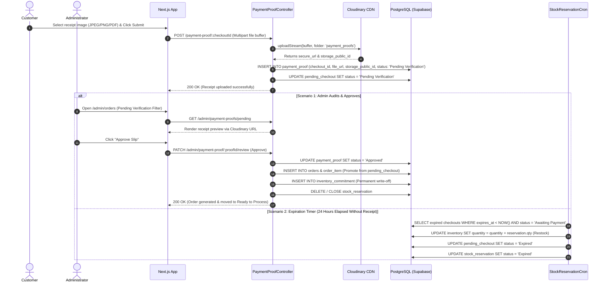

# Vergo Wear - Developer Documentation
**Course:** Team Software Project (CSC304S3 / CSC304G3)  
**Project:** Vergo Wear - Custom Apparel & E-Commerce Order Management System  
**Document Type:** Developer Documentation  
**Date:** October 2026  
**Document Version:** 1.0.0  

---

## Table of Contents
1. [Copyright's Statement](#1-copyrights-statement)
2. [Executive Summary](#2-executive-summary)
3. [Objective of the Project](#3-objective-of-the-project)
4. [Customer](#4-customer)
5. [Problem Statement](#5-problem-statement)
6. [Proposed Solution](#6-proposed-solution)
   - 6.1 [Team Details](#61-team-details)
   - 6.2 [Software Details](#62-software-details)
   - 6.3 [System Overview](#63-system-overview)
     - Core Functionalities
     - How to Test Core Functionalities
     - Known Bugs and Limitations
   - 6.4 [System Diagrams](#64-system-diagrams)
     - Use Case Diagram (Whole System)
     - Class Diagram (Main Components & Domain Entities)
     - Sequence Diagrams (Core Workflows: Order Placement, Payment Proof Verification, Employee Order Claiming)
   - 6.5 [Main Components, Classes, and Graphical User Interfaces (GUI)](#65-main-components-classes-and-graphical-user-interfaces-gui)
     - Frontend Component Hierarchy and State Structure
     - Backend Service Architecture and Modules
     - Database Entity Relationship and Data Integrity
   - 6.6 [More Information](#66-more-information)
     - GitHub Repository
     - Project Blog / Documentation Links

---

## 1. Copyright's Statement

```
Copyright (c) 2026 Vergo Wear Development Team.
Department of Computer Science, Faculty of Science, University of Jaffna.

All rights reserved.

This software, source code, design models, documentation, and graphical assets are 
the intellectual property of the Vergo Wear Team for the course module 
"Team Software Project (CSC304S3 / CSC304G3)". 

Permission is hereby granted, free of charge, to instructors, supervisors, 
reviewers, and collaborators to inspect, test, and run the software. 

Redistribution, reproduction, commercial exploitation, or modification of any part 
of this software without prior written authorization from the authors or the client 
(Vergo Wear) is strictly prohibited.
```

---

## 2. Executive Summary

**Vergo Wear** is an enterprise-grade custom order management and e-commerce web platform engineered for modern apparel brands. While standard off-the-shelf e-commerce platforms handle standard retail well, apparel businesses face unique challenges: bespoke size customization, multi-branch localized inventory management, multi-stage production fulfillment (preparing, sewing, quality inspection, packaging), dual payment models (Cash on Delivery and Bank Transfer slip uploads with administrative audit verification), and courier partner integrations (Citypak / Koombiyo courier APIs).

The system is constructed with a dual-tier modern web architecture:
- **Frontend Client:** Built using **Next.js 16 (React 19)**, TypeScript, Tailwind CSS, and custom responsive layouts, providing dedicated portals for Customers (storefront, cart, customized design orders, order tracking), Employees (order claiming queue, product preparation, inventory dispatch), and Administrators (financial analytics, inventory reordering, staff commission, and review moderation).
- **Backend Service:** Powered by **NestJS 11** with TypeScript, structured according to enterprise modular design patterns, domain services, dependency injection, and data validation pipes.
- **Data & Security Tier:** Leverages **Supabase PostgreSQL** with Prisma ORM, enforced with Row Level Security (RLS) policies, atomic stock reservations, cryptographic JWT validation, and Cloudinary media processing.

The platform provides end-to-end transparency, significantly reducing order processing delays, eliminating overselling via real-time reservation locks, and offering real-time visibility into customer orders from fabrication to doorstep delivery.

---

## 3. Objective of the Project

The core objectives of the Vergo Wear system include:

1. **Streamline Custom & Standard Apparel Ordering:** Provide an intuitive online shopping experience where customers can browse collections, configure variant options (size, color, custom embroidery/printing options), add to cart, and checkout seamlessly.
2. **Automate Inventory and Multi-Branch Tracking:** Manage physical stock per variant across individual retail branches, tracking available, reserved, and threshold reorder levels to prevent stockouts or overselling.
3. **Digitize Payment Verification:** Facilitate secure checkout via Cash on Delivery (COD) and manual Bank Deposit slip uploads, backed by an automated verification portal that expires unverified slips and frees up reserved stock automatically.
4. **Implement Role-Based Operational Dashboards:** Empower floor employees with real-time order claim queues and fulfillment steps (Ready to Process → Preparing → Ready → Sent for Delivery) and give administrators consolidated control over inventory, employees, commissions, suppliers, and analytics.
5. **Seamless Delivery Logistics Integration:** Integrate automated dispatch handoffs with third-party logistics partners (Citypak/Koombiyo API) including airway bill generation, automated webhook tracking updates, and delivery fee calculation by geographic district.
6. **Ensure Robust Software Engineering Standards:** Comply with clean code standards, comprehensive unit/integration test coverage, role-based guard authorization, and auditability.

---

## 4. Customer

The primary stakeholders and customer entities interacting with this platform are:

| Customer Group | Description | Primary Needs / Expectations |
| :--- | :--- | :--- |
| **Direct Retail Shoppers (B2C)** | End-consumers seeking stylish urban wear, custom printed/embroidered clothing, and seasonal collections. | Easy mobile-first checkout, clear sizing guides, secure payment methods, real-time tracking, transparent notifications. |
| **Vergo Wear Business Owners / Admins** | The managerial leadership overseeing business operations, sales, profits, and staffing. | Centralized dashboard, automated revenue/earnings reports, staff commission tracking, supplier replenishment, product creation. |
| **Floor & Branch Employees** | Factory and showroom staff responsible for picking, custom prep, packaging, and dispatch. | Dedicated fulfillment interface, instant claim queue, visual order item checklist, stock alert visibility. |
| **Logistics & Delivery Partners** | Delivery couriers (Citypak / Koombiyo / in-house riders). | Automated parcel manifests, delivery address standardization, status webhooks, COD cash reconciliation. |

---

## 5. Problem Statement

Small-to-medium apparel businesses and custom apparel brands in Sri Lanka face major operational bottlenecks when operating through disparate channels (e.g., social media DM orders, manual Excel sheets, and disconnected point-of-sale registers):

1. **Inventory Discrepancy & Overselling:** Inventory is often shared between physical branch shelves and online orders. When customers order items via bank transfer, items remain on hold indefinitely without payment verification, locking inventory or leading to overselling when physical customers buy the same piece.
2. **Manual and Error-Prone Bank Slip Verification:** Over 50% of local online transactions occur via direct bank transfer. Reconciling payment slips sent via WhatsApp/email against bank accounts manually causes processing delays of 24–48 hours, lost receipts, and fraudulent fake payment slips.
3. **Lack of Order Transparency for Customers:** Customers frequently inundate support staff inquiring about order status ("Where is my parcel? Has my customized hoodie started printing?").
4. **Disorganized Floor Fulfillment:** Production and packing employees lack a unified digital board to claim orders, update status milestones, and log handover to delivery drivers.
5. **Geographic Delivery Fee Inconsistency:** Variable courier rates across 25 administrative districts result in miscalculated delivery charges and manual adjustments post-purchase.

Vergo Wear provides an integrated, automated software solution resolving every one of these operational pain points.

---

## 6. Proposed Solution

### 6.1 Team Details

**Course Unit:** Team Software Project (CSC304S3 / CSC304G3)  
**Institution:** Department of Computer Science, Faculty of Science, University of Jaffna  

| Member Name | Student Registration No | Role | Key Responsibilities |
| :--- | :--- | :--- | :--- |
| **Pamuda Uposath De Alwis Goonatilake** | *Team Lead & Full-Stack Architect* | Project Architecture, Backend Lead, Prisma/PostgreSQL, Authentication & Customization Engines |
| **S. Himath Hansana Senasinghe** | `2022/CSC/068` | Frontend Lead & UI/UX Designer | Next.js App Router, Storefront & Admin GUI, Responsive Styling, Customer Experience |
| **Bhagya Sandakelum** | `2022/CSC/030` | Backend & Integration Engineer | Payment Proof Verification, Citypak/Courier API Integrations, Delivery Rules & Webhooks |
| **Pasidu Chamod** | `2022/CSC/xxx` | Full-Stack & QA Engineer | Employee Fulfillment Dashboard, Stock Reservation Module, Automated Spec Testing |
| **Vihanga Nethsara** | `2022/CSC/xxx` | Database & Security Engineer | Supabase RLS Policies, Review System, Address Book & Profile Management |

---

### 6.2 Software Details

- **Software Name:** Vergo Wear E-Commerce & Order Management Platform
- **Current Version:** `1.0.0-Release`
- **License:** Open Academic License / MIT License
- **Target Deployment Platform:** Cloud Native (Vercel for Frontend, Render/AWS ECS for Backend, Supabase Cloud for Database, Cloudinary for CDN Storage)
- **Programming Languages:** TypeScript (Frontend & Backend), SQL (PostgreSQL DDL/DML)
- **Key Frameworks & Libraries:**
  - Frontend: `Next.js 16.2.9`, `React 19.2.4`, `Tailwind CSS 4.0`, `Leaflet`, `React Joyride`
  - Backend: `NestJS 11.0.1`, `@prisma/client 6.2.0`, `Express`, `Passport/Supabase Auth`, `Helmet`, `Nodemailer`, `Axios`
  - Database: `PostgreSQL 15+` hosted on `Supabase`

---

### 6.3 System Overview

#### Core Functionality
1. **Product Catalogue & Variant Management:**
   - Products are categorized and linked to suppliers.
   - Each product has multiple distinct SKUs (size, color, and price adjustment).
   - Multi-branch inventory tracking allows real-time stock deductions per branch.
2. **Customer Shopping Experience:**
   - Interactive storefront, collection browsing, real-time multi-criteria filtering (size, color, price range, category).
   - Dynamic persistent cart for authenticated users and local temporary session cart for guests.
   - 3-step streamlined checkout: Contact lookup, Shipping Address with district-based fee calculation, and Payment selection.
3. **Dual Payment Gateway:**
   - Cash on Delivery (COD) with automated COD fee calculation.
   - Bank Deposit: Secure slip upload via Cloudinary CDN, automated expiration window (24 hours), and admin verification portal.
4. **Two-Phase Stock Reservation Engine:**
   - When an order is placed, stock is atomically moved from `quantity` to `reserved_quantity`.
   - Upon payment confirmation, reserved stock is finalized.
   - If payment proof expires or is rejected, a scheduled cron task automatically releases reserved stock back into available quantity.
5. **Employee Order Fulfillment Queue:**
   - Floor workers log in with `employee` privileges to view real-time orders in `Ready to Process`.
   - Single-click "Claim Order" locks the order to the employee to avoid duplicate handling.
   - Status transitions: `Claimed by Employee` → `Preparing` → `Ready` → `Sent for Delivery`.
6. **Logistics & Citypak Courier Integration:**
   - Automated delivery order generation sending package weights, dimensions, and receiver details.
   - Tracking webhook endpoint updating customer delivery status.
7. **Comprehensive Admin Dashboard:**
   - Financial analytics (revenue, daily orders, profit margins, average order value).
   - Inventory alerts (reorder level monitoring, low-stock notifications).
   - Employee performance, commission calculation, customer feedback & review approval.

#### How to Test Core Functionalities
The software includes automated unit, integration, and E2E test suites, alongside structured manual test procedures:

1. **Automated Backend Testing:**
   - Run unit test suites: `npm run test` (executes 14 `.spec.ts` suites across auth, orders, cart, inventory, and payment modules).
   - Run coverage analysis: `npm run test:cov` (checks coverage thresholds across controllers and services).
   - Run end-to-end API tests: `npm run test:e2e` (validates HTTP status codes, validation pipes, and error handlers).
2. **Automated Frontend Testing:**
   - Run TypeScript type safety verification: `npm run typecheck`.
   - Run ESLint linting: `npm run lint`.
3. **Manual Core Workflow Testing:**
   - **Auth Flow:** Register customer at `/auth/register`, verify email/password validation, sign in at `/auth/login`, verify JWT session storage.
   - **Store & Cart Flow:** Navigate to `/collection`, select product variant, add to cart, verify persistent cart database record.
   - **Checkout & Stock Lock:** Complete checkout with Bank Transfer, check database: verify `inventory.quantity` decreases and `reserved_quantity` increases.
   - **Admin Payment Approval:** Log in as admin (`/admin/orders`), view uploaded receipt slip, click "Approve", verify order transitions to `Ready to Process`.
   - **Employee Fulfillment:** Log in as employee (`/employee/orders`), claim order, advance through `Preparing` to `Ready`.

#### Known Bugs & Limitations
As documented in the system review ledger:
- **Guest Checkout State:** Guest cart currently relies on browser session storage; closing the tab clears guest selections before registration.
- **Physical Barcode Scanning:** Scanning physical apparel tags currently requires manual SKU entry into the employee order fulfillment UI (hardware Bluetooth barcode scanner direct API integration is queued for v1.1).
- **Courier API Mock Mode in Staging:** When live Citypak sandbox credentials are unavailable, the integration module runs in fallback sandbox simulation mode.

---

### 6.4 System Diagrams

#### 1. Use Case Diagram (Whole System)

```mermaid
flowchart TD
    subgraph Actors
        C((Customer))
        E((Employee))
        A((Administrator))
        L((Logistics / Courier))
    end

    subgraph Storefront & Account
        UC1[Browse Catalog & Filter Variants]
        UC2[Manage Shopping Cart]
        UC3[Checkout & Select Shipping]
        UC4[Upload Bank Payment Slip]
        UC5[Track Order Status]
        UC6[Submit Product Review]
    end

    subgraph Fulfillment Queue
        UC7[View Available Orders]
        UC8[Claim Order for Packing]
        UC9[Update Order Milestone]
        UC10[Check Branch Inventory]
    end

    subgraph Administration & Operations
        UC11[Approve / Reject Payment Slips]
        UC12[Create & Manage Products/Variants]
        UC13[Monitor Sales Analytics & Profit]
        UC14[Manage Employee Commissions]
        UC15[Moderate Customer Reviews]
    end

    subgraph Integrations
        UC16[Airway Bill Dispatch API]
        UC17[Delivery Status Webhook]
        UC18[Email / WhatsApp Notifications]
    end

    C --> UC1
    C --> UC2
    C --> UC3
    C --> UC4
    C --> UC5
    C --> UC6

    E --> UC7
    E --> UC8
    E --> UC9
    E --> UC10

    A --> UC11
    A --> UC12
    A --> UC13
    A --> UC14
    A --> UC15

    L --> UC17
    UC9 --> UC16
    UC3 --> UC18
    UC11 --> UC18
```



---

#### 2. Class Diagram (Main Components & Domain Entities)

```mermaid
classDiagram
    class Profile {
        +UUID id
        +UUID role_id
        +String username
        +String status
        +Boolean must_change_password
        +DateTime created_at
    }

    class Customer {
        +UUID customer_id
        +UUID profile_id
        +String first_name
        +String last_name
        +String contact_email
        +String contact_phone
    }

    class Employee {
        +UUID employee_id
        +UUID profile_id
        +UUID branch_id
        +String first_name
        +String last_name
        +String position
        +String availability_status
        +Decimal salary
        +Decimal commission_per_parcel
    }

    class Product {
        +UUID product_id
        +UUID category_id
        +UUID supplier_id
        +String name
        +String description
        +Decimal base_price
        +String status
    }

    class Color {
        +UUID color_id
        +String name
        +String hex_code
        +String image_url
    }

    class Size {
        +UUID size_id
        +String name
        +Int display_order
    }

    class ProductVariant {
        +UUID variant_id
        +UUID product_id
        +UUID color_id
        +UUID size_id
        +String sku
        +Decimal price_adjustment
        +String status
    }

    class Inventory {
        +UUID inventory_id
        +UUID variant_id
        +UUID branch_id
        +Int quantity
        +Int reorder_level
        +UUID employee_id
    }

    class PendingCheckout {
        +UUID checkout_id
        +UUID customer_id
        +String payment_method
        +String status
        +Decimal delivery_fee
        +Decimal total_amount
        +DateTime expires_at
    }

    class StockReservation {
        +UUID reservation_id
        +UUID inventory_id
        +UUID checkout_id
        +Int quantity
        +String status
        +DateTime expires_at
    }

    class PaymentProof {
        +UUID payment_proof_id
        +UUID checkout_id
        +String file_url
        +String storage_public_id
        +String mime_type
        +Int file_size_bytes
        +String status
        +String rejection_reason
    }

    class Order {
        +UUID order_id
        +UUID customer_id
        +UUID employee_id
        +UUID branch_id
        +UUID checkout_id
        +Decimal total_amount
        +String payment_method
        +String order_status
        +DateTime order_date
        +DateTime claimed_at
        +DateTime preparing_at
        +DateTime delivered_at
    }

    class OrderItem {
        +UUID order_item_id
        +UUID order_id
        +UUID variant_id
        +Int quantity
        +Decimal unit_price
        +Decimal subtotal
    }

    class InventoryCommitment {
        +UUID commitment_id
        +UUID inventory_id
        +UUID order_item_id
        +Int quantity
        +String status
        +DateTime committed_at
    }

    class Delivery {
        +UUID delivery_id
        +UUID order_id
        +String courier_name
        +String waybill_number
        +String delivery_status
        +Decimal cod_amount
        +String pod_image_url
    }

    Profile "1" <|-- "1" Customer : specializes
    Profile "1" <|-- "1" Employee : specializes
    Product "1" *-- "1..*" ProductVariant : has
    Color "1" -- "0..*" ProductVariant : assigns
    Size "1" -- "0..*" ProductVariant : assigns
    ProductVariant "1" *-- "0..*" Inventory : branch_stock
    Inventory "1" *-- "0..*" StockReservation : locks
    PendingCheckout "1" *-- "1..*" StockReservation : reserves
    PendingCheckout "1" *-- "0..1" PaymentProof : verifies_with
    PendingCheckout "1" --> "0..1" Order : promotes_to
    Order "1" *-- "1..*" OrderItem : contains
    OrderItem "1" --> "1" InventoryCommitment : commits_stock
    Order "1" *-- "0..1" Delivery : dispatches
    Employee "1" --> "0..*" Order : fulfills

---

#### 3. Sequence Diagrams (Core Workflows)

##### Sequence Diagram A: Two-Phase Checkout & Atomic Stock Reservation

```mermaid
sequenceDiagram
    autonumber
    actor Customer as Customer Client
    participant Frontend as Next.js Storefront
    participant OrderCtrl as Orders / Checkout Controller
    participant StockSvc as StockReservationService
    participant Prisma as Prisma / PostgreSQL
    participant Email as EmailService

    Customer->>Frontend: Select Variant & Click "Proceed to Checkout"
    Frontend->>OrderCtrl: POST /checkout/initiate (Items, Address, Payment Method)
    OrderCtrl->>StockSvc: createPendingCheckout(payload)
    
    rect rgb(240, 248, 255)
        Note over StockSvc,Prisma: Atomic Stock Lock Transaction
        StockSvc->>Prisma: Check branch inventory (quantity >= requested)
        alt Stock Insufficient
            Prisma-->>StockSvc: Stock below requested qty
            StockSvc-->>OrderCtrl: 400 Bad Request ("Insufficient stock")
            OrderCtrl-->>Frontend: Display Out-of-Stock alert
        else Stock Available
            StockSvc->>Prisma: INSERT INTO pending_checkout & pending_checkout_item
            StockSvc->>Prisma: INSERT INTO stock_reservation (inventory_id, checkout_id, qty, status: 'Active')
            StockSvc->>Prisma: UPDATE inventory SET quantity = quantity - qty
            Prisma-->>StockSvc: Reservation lock confirmed
        end
    end

    alt Payment Method is COD
        StockSvc->>Prisma: INSERT INTO orders & order_item & inventory_commitment
        StockSvc->>Email: sendOrderConfirmation()
        OrderCtrl-->>Frontend: 201 Created (Order placed, Ready to Process)
    else Payment Method is Bank Transfer
        OrderCtrl-->>Frontend: 201 Created (checkout_id, 24h expiration timer)
        Frontend-->>Customer: Show Bank Details & Receipt Upload UI
    end
```

##### Sequence Diagram B: Cloudinary Slip Upload & Admin Verification Lifecycle



---

### 6.5 Main Components, Classes, and Graphical User Interfaces (GUI)

#### 1. Frontend Component & GUI Structure

The frontend is architectured using Next.js 16 App Router route grouping:

```
frontend/src/
├── app/
│   ├── (store)/                 # Public Customer Storefront
│   │   ├── page.tsx             # Landing hero, featured collections, USP badges
│   │   ├── collection/          # Product catalogue with live category & size filters
│   │   │   └── [id]/page.tsx    # Single product details, variant selectors, reviews
│   │   ├── cart/page.tsx        # Persistent shopping cart with quantity adjustments
│   │   ├── checkout/            # Multi-step checkout
│   │   │   ├── page.tsx         # Contact lookup & identification
│   │   │   ├── shipping/page.tsx# Shipping address & District rate selector
│   │   │   └── payment/page.tsx # COD or Bank slip upload
│   │   └── profile/             # Customer personal portal
│   │       ├── page.tsx         # Personal information & saved addresses
│   │       ├── orders/          # Historical order listing & invoice downloads
│   │       └── orders/[id]/     # Order timeline & status tracking
│   │
│   ├── (employee)/              # Floor Fulfillment Staff Portal
│   │   ├── employee/page.tsx    # Dashboard overview & active shift statistics
│   │   ├── employee/orders/     # Unclaimed orders queue (Ready to Process)
│   │   ├── product-prep/        # Checklist for cutting, printing, stitching
│   │   ├── delivery-prep/       # Airway bill manifest & courier package tagging
│   │   └── stock/page.tsx       # Branch inventory level checks
│   │
│   └── (admin)/                 # Administrative Control Center
│       ├── admin/page.tsx       # KPI revenue cards, sales velocity, order metrics
│       ├── admin/orders/        # Order inspection, payment approval modal
│       ├── admin/inventory/     # Stock addition, branch transfers, reorder limits
│       ├── admin/employees/     # Staff attendance, payroll, sales commission rates
│       ├── admin/feedbacks/     # Review moderation & customer contact messages
│       └── product-creation/    # New product & variant SKU generator
```

#### 2. Backend Classes & Module Architecture

The backend utilizes modular NestJS controllers, services, guards, and DTO classes:

```
backend/src/
├── auth/                        # Authentication & Guard Subsystem
│   ├── auth.controller.ts       # Signup, Signin, Google OAuth endpoints
│   ├── auth.service.ts          # Supabase Auth client, JWT verification
│   └── guards/roles.guard.ts    # Role-based Access Control (Customer, Employee, Admin)
│
├── product-catalogue/           # Product & Inventory Domain
│   ├── product-catalogue.controller.ts
│   ├── product-catalogue.service.ts
│   └── dto/create-product.dto.ts
│
├── orders/                      # Order Processing & Management
│   ├── orders.controller.ts     # Customer & Admin order queries
│   └── orders.service.ts        # Order creation, total calculation, status updates
│
├── stock-reservation/           # Concurrency-Safe Stock Reservation
│   ├── stock-reservation.service.ts # Atomic reservation & rollback
│   └── stock-reservation.cron.ts    # Automated hourly expiration cleanup
│
├── payment-proof/               # Bank Slip Verification Engine
│   ├── payment-proof.controller.ts
│   └── payment-proof.service.ts
│
└── integrations/citypak/        # Logistics & Courier API
    ├── citypak.service.ts       # Consignment creation, tracking queries
    └── citypak-webhook.controller.ts # Inbound status update webhooks
```

---

### 6.6 More Information

- **Official Git Repository:** [https://github.com/Vergo-Wear/vergo-app.git](https://github.com/Vergo-Wear/vergo-app.git)
- **Technical Architecture Specification:** [DATABASE_SCHEMA.md](file:///e:/All%20Projects/GitHub_Projects/Vergo-Wear/vergo-app/vergo-app/backend/prisma/DATABASE_SCHEMA.md)
- **Review & Implementation Ledger:** [REVIEW_STATUS.md](file:///e:/All%20Projects/GitHub_Projects/Vergo-Wear/vergo-app/vergo-app/REVIEW_STATUS.md)
- **API Endpoints Reference:** See companion file `03_API_SPECIFICATION.md`
- **Security & RBAC Architecture:** See companion file `04_SECURITY_ARCHITECTURE.md`
- **QA & Test Matrix:** See companion file `05_TEST_CASES_AND_QUALITY_ASSURANCE.md`
