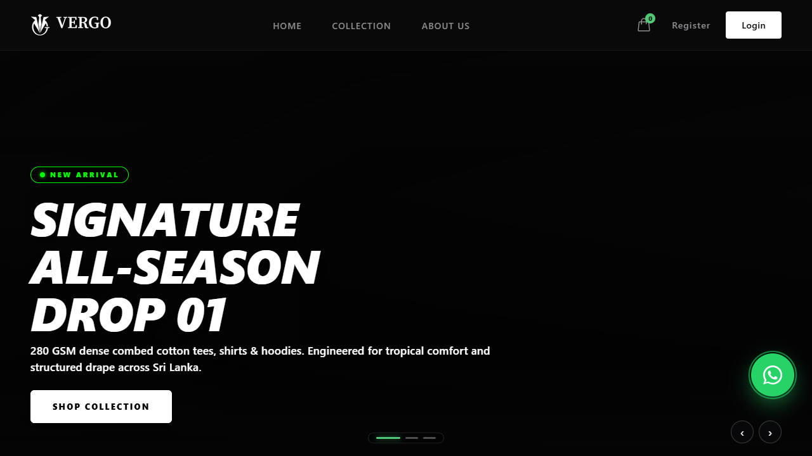
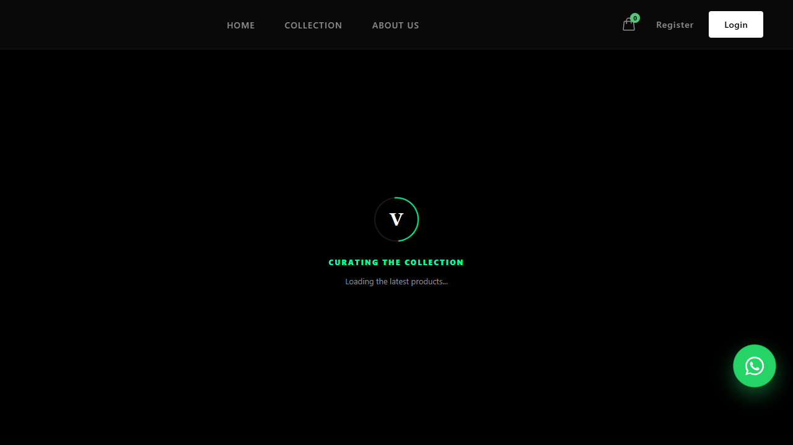
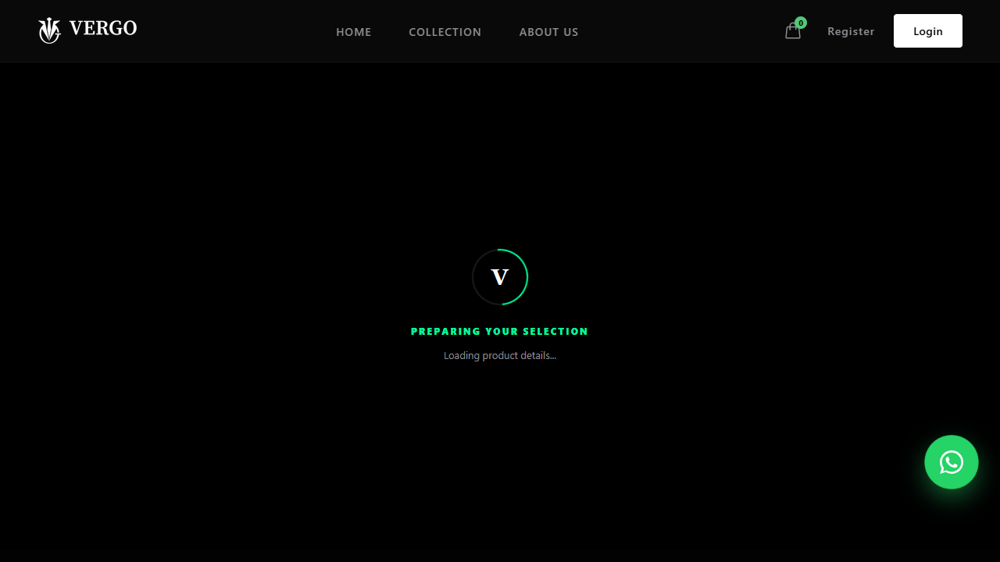
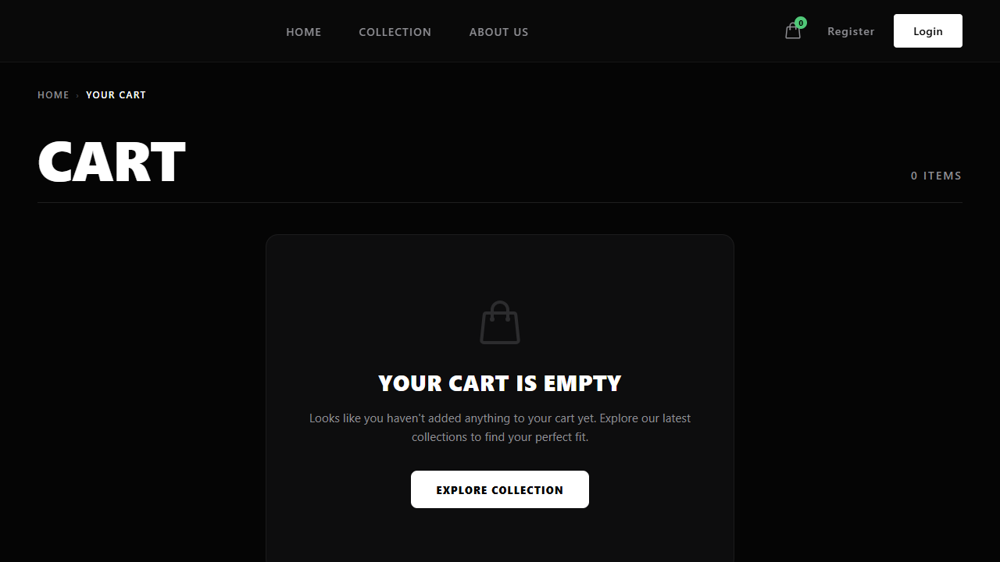
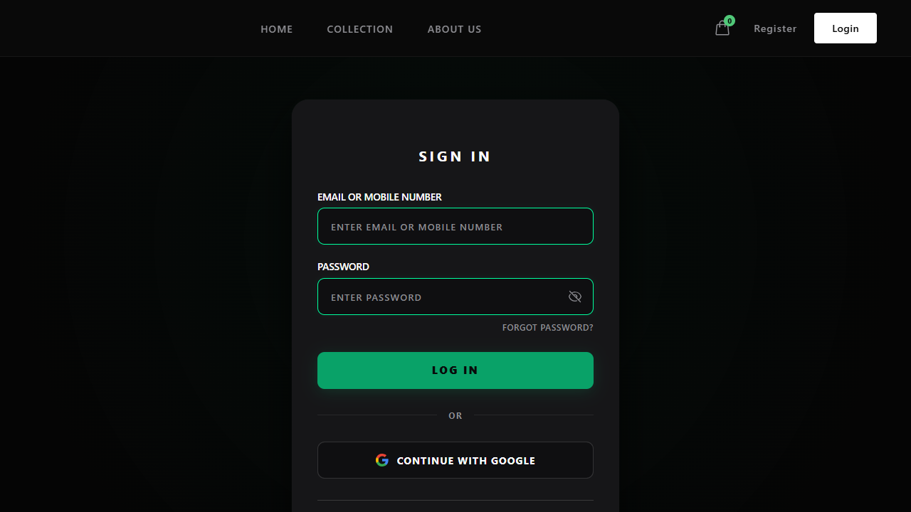
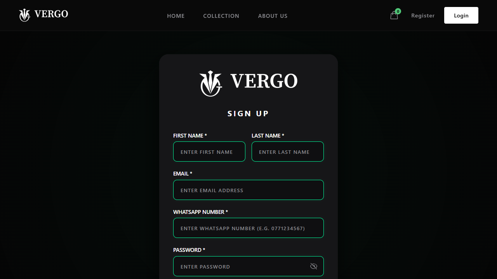

# Vergo Wear - User Documentation & Operating Guide

**Course:** Team Software Project (CSC304S3 / CSC304G3)  
**Department:** Department of Computer Science, Faculty of Science, University of Jaffna  
**Project Title:** Vergo Wear - Custom Apparel & E-Commerce Order Management Platform  
**Submission Date:** November 2026  
**Document Version:** 2.0.0 (Production Release)  

---

## Table of Contents

1. [Title Page](#1-title-page)
2. [Copyright & Licensing](#2-copyright--licensing)
3. [Introduction](#3-introduction)
4. [Installation Guide](#4-installation-guide)
   - 4.1 [Prerequisites & System Requirements](#41-prerequisites--system-requirements)
   - 4.2 [Installation Steps & Application Setup](#42-installation-steps--application-setup)
   - 4.3 [Default User Accounts & Demonstration Logins](#43-default-user-accounts--demonstration-logins)
5. [Getting Started with the Interface](#5-getting-started-with-the-interface)
   - 5.1 [Main Features Overview](#51-main-features-overview)
   - 5.2 [Navigating the Storefront Portal (Customer Experience)](#52-navigating-the-storefront-portal-customer-experience)
   - 5.3 [Navigating the Workshop Fulfillment Portal (Employee Experience)](#53-navigating-the-workshop-fulfillment-portal-employee-experience)
   - 5.4 [Navigating the Management Control Center (Administrator Experience)](#54-navigating-the-management-control-center-administrator-experience)
   - 5.5 [Terminology & Glossary](#55-terminology--glossary)
6. [Troubleshooting and FAQs](#6-troubleshooting-and-faqs)
   - 6.1 [Common Operational Issues & Solutions](#61-common-operational-issues--solutions)
   - 6.2 [Frequently Asked Questions (FAQ)](#62-frequently-asked-questions-faq)
7. [Support Information](#7-support-information)
   - 7.1 [Point of Contact Details](#71-point-of-contact-details)
   - 7.2 [User Support Resources & Project Links](#72-user-support-resources--project-links)

---

## 1. Title Page

```
========================================================================================
                         UNIVERSITY OF JAFFNA, SRI LANKA
                               FACULTY OF SCIENCE
                        DEPARTMENT OF COMPUTER SCIENCE

                     TEAM SOFTWARE PROJECT (CSC304S3 / CSC304G3)
                               USER DOCUMENTATION

                                   VERGO WEAR
               Custom Apparel E-Commerce & Order Management Platform

                                 Version: 2.0.0
                            Submission Date: November 2026
========================================================================================
```

---

## 2. Copyright & Licensing

```
Copyright (c) 2026 Vergo Wear Development Team.
Department of Computer Science, Faculty of Science, University of Jaffna.

All rights reserved.

This software, source code, design models, documentation, and graphical user interfaces 
are the intellectual property of the Vergo Wear Team developed under course module 
"Team Software Project (CSC304S3 / CSC304G3)". 

Permission is hereby granted, free of charge, to course instructors, examiners, 
reviewers, and authorized stakeholders to inspect, test, navigate, and evaluate the 
delivered application. 

Commercial reproduction, redistribution, or unauthorized distribution of this software 
or guide without prior written consent from the authors and Vergo Wear is strictly prohibited.
```

---

## 3. Introduction

**Vergo Wear** is a modern, all-in-one web platform created for fashion enthusiasts, branch workshop staff, and apparel business managers. For online shoppers, it delivers a smooth e-commerce experience where you can browse premium urban apparel, customize garment prints, view accurate branch availability, and place orders with instant Cash on Delivery or secure bank transfer receipts. Behind the scenes, the system connects workshop craftsmen and store owners through real-time order tracking, digital packing checklists, automatic 24-hour bank slip verification, direct thermal barcode shipping label generation, and automated parcel delivery updates powered by Citypak Couriers and Resend transactional email notifications.

---

## 4. Installation Guide

### 4.1 Prerequisites & System Requirements

To run the Vergo Wear platform locally for demonstration or deployment, verify that your computer meets the following minimum system requirements:

- **Operating System:** Windows 10/11, macOS Monterey+, or Linux (Ubuntu 22.04+).
- **Web Browser:** Google Chrome 110+, Mozilla Firefox 110+, Microsoft Edge, or Apple Safari 16+.
- **Node.js Runtime:** Version `20.x` or `22.x` (LTS recommended).
- **Package Manager:** `npm` version 10+.
- **Git:** Version 2.30+ installed and available in the system PATH.
- **Network Connection:** Active internet connectivity (for Supabase PostgreSQL, Cloudinary CDN, and Citypak/Resend API services).

### 4.2 Installation Steps & Application Setup

Follow these straightforward steps to set up the software:

```
[Clone Repository] ──> [Install Backend Dependencies] ──> [Configure .env]
                             │
                             ▼
                    [Generate Database Client] ──> [Start NestJS API (Port 3001)]
                             │
                             ▼
[Install Frontend Dependencies] ──> [Configure .env.local] ──> [Start Next.js (Port 3000)]
```

#### Step 1: Clone the Project Source Code
Open your command terminal (PowerShell, Terminal, or Bash) and run:
```bash
git clone https://github.com/Vergo-Wear/vergo-app.git
cd vergo-app
```

#### Step 2: Install and Configure Backend Service
1. Navigate to the backend folder:
   ```bash
   cd backend
   npm install
   ```
2. Create the configuration file `.env` by copying `.env.example`:
   ```bash
   cp .env.example .env
   ```
   Ensure the following essential variables are populated:
   ```ini
   PORT=3001
   FRONTEND_URL=http://localhost:3000
   DATABASE_URL="postgresql://postgres.[REF]:[PASS]@[HOST]:5432/postgres"
   DIRECT_URL="postgresql://postgres.[REF]:[PASS]@[HOST]:5432/postgres"
   SUPABASE_URL=https://[YOUR-PROJECT-REF].supabase.co
   SUPABASE_ANON_KEY=[YOUR-ANON-KEY]
   CLOUDINARY_CLOUD_NAME=[YOUR_CLOUD_NAME]
   CLOUDINARY_API_KEY=[YOUR_API_KEY]
   CLOUDINARY_API_SECRET=[YOUR_API_SECRET]
   RESEND_API_KEY=[YOUR_RESEND_API_KEY]
   CITYPAK_BASE_URL=https://staging.citypak.lk
   ```
3. Generate the Prisma database client:
   ```bash
   npx prisma generate
   ```
4. Start the backend development server:
   ```bash
   npm run start:dev
   ```
   *The backend will initialize and listen on `http://localhost:3001`.*

#### Step 3: Install and Configure Frontend Application
1. In a separate terminal tab, navigate to the frontend folder:
   ```bash
   cd ../frontend
   npm install
   ```
2. Create `.env.local` inside `frontend/`:
   ```ini
   NEXT_PUBLIC_API_URL=http://localhost:3001
   NEXT_PUBLIC_SUPABASE_URL=https://[YOUR-PROJECT-REF].supabase.co
   NEXT_PUBLIC_SUPABASE_ANON_KEY=[YOUR-ANON-KEY]
   ```
3. Start the Next.js storefront client:
   ```bash
   npm run dev
   ```
   *The storefront client will be accessible at `http://localhost:3000` in your web browser.*

---

### 4.3 Default User Accounts & Demonstration Logins

The application includes pre-configured user credentials across the three role portals:

| Portal | Role | Email Address | Password | Intended Workflow |
| :--- | :--- | :--- | :--- | :--- |
| **Customer Storefront** | Registered Buyer | `customer@vergo.lk` | `Password123!` | Browsing collections, cart, checkout, slip upload, order tracking. |
| **Workshop Portal** | Workshop Floor Staff | `employee@vergo.lk` | `EmployeePass123!` | Claiming orders, product prep checklist, ready orders & courier handover. |
| **Admin Control Center** | Store Manager / Admin | `admin@vergo.lk` | `AdminPass123!` | Financial KPIs, bank slip review modal, stock distribution, review moderation. |

---

## 5. Getting Started with the Interface

### 5.1 Main Features Overview

1. **Apparel Storefront & Dynamic Sizing:** Interactive collection browsing with instant multi-attribute filters (Category, Size, Color Swatch, Price Slider) and live price adjustments for oversized/specialty cuts.
2. **Two-Phase Checkout & Stock Locks:** 3-step checkout with district-based Sri Lankan shipping fees. Items are atomically reserved for 24 hours while bank transfer receipts are uploaded.
3. **Paperless Bank Slip Audit:** Direct upload of ATM deposit screenshots or banking app receipts; administrators review high-resolution previews in one click.
4. **Workshop Fulfillment Board:** Real-time claiming queue preventing duplicate packing, tamper-proof protected financial fields, and personal stock inventory management.
5. **Citypak Logistics Integration:** On-demand printing of thermal Code 128 4x6 adhesive shipping waybills, courier truck pickup requests, and live parcel milestone tracking.
6. **Resend Email Notifications:** Automated, branded transactional emails for order confirmations, slip approvals/rejections, stock requests, and courier dispatch.

---

### 5.2 Navigating the Storefront Portal (Customer Experience)

```
[Storefront Home] ──> [Collection & Filters] ──> [Product Detail & Customizer]
         │                                                      │
         ▼                                                      ▼
[Order Tracking & Invoices] <── [3-Step Checkout] <── [Shopping Cart Drawer]
```

```
+---------------------------------------------------------------------------------------+
|  VERGO WEAR      [Collection]  [Customizer]  [About Us]          [Search] [Cart (2)] [Profile] |
+---------------------------------------------------------------------------------------+
|                                                                                       |
|   OVERSIZED HOODIE 2026 EDITION                                                       |
|   Streetwear Redefined. Heavyweight 420GSM French Terry Cotton.                       |
|   [EXPLORE COLLECTION]                                                                |
|                                                                                       |
+---------------------------------------------------------------------------------------+
|  FILTERS:                     |  PRODUCTS:                                            |
|  [x] Hoodies   [ ] T-Shirts   |  +--------------------+   +--------------------+       |
|  Size: [S] [M] [*L*] [XL]     |  |  [ Garment Image ] |   |  [ Garment Image ] |       |
|  Colors: [Black] [Sand] [Sage]|  |  Cyberpunk Hoodie  |   |  Boxy Fit Tee      |       |
|  Price: Rs. 3,500 - 12,000    |  |  Rs. 7,800  [BUY]  |   |  Rs. 4,200  [BUY]  |       |
+---------------------------------------------------------------------------------------+
```


*Figure 5.1: Live Vergo Wear Storefront Homepage (`https://vergo.lk`)*

1. **Browsing Collections (`/collection`):**
   - Click **Collection** in the top navigation bar to open the product grid.
   - Use the left sidebar to filter by category (e.g. Hoodies, Tees, Cargo Pants), size, or color.
   - Prices update dynamically without reloading the page.


*Figure 5.2: Live Product Collection & Multi-Filter Catalog View (`https://vergo.lk/collection`)*

2. **Product Page & Variant Selection (`/collection/[id]`):**
   - Choose your preferred Color swatch and Size.
   - The screen shows real-time available branch stock and adjusts the price if a specialty size (e.g. XXL) applies an extra fee.
   - Click **Add to Cart** to update your persistent shopping cart.


*Figure 5.3: Garment Detail Page with Variant Selectors and Sizing Guide*

3. **Reviewing Cart (`/cart`):**
   - Review selected garment styles, adjust quantities, or remove items.
   - Subtotals and item counts recalculate immediately. Click **Proceed to Checkout**.


*Figure 5.4: Shopping Cart and Order Subtotal Summary (`https://vergo.lk/cart`)*

4. **Customer Login & Account Access (`/auth/login`):**
   - Secure customer sign-in with email, password, and Google OAuth options.


*Figure 5.5: Customer Authentication Portal (`https://vergo.lk/auth/login`)*

5. **Customer Registration (`/auth/register`):**
   - New user onboarding with strict password policy verification and email validation.


*Figure 5.6: Customer Registration Portal (`https://vergo.lk/auth/register`)*

6. **Three-Step Checkout (`/checkout`):**
   - **Step 1 - Contact Details:** Authenticated users see saved details; guests enter name, email, and phone number.
   - **Step 2 - Shipping Address:** Select your administrative district (e.g., Colombo, Kandy, Jaffna). The exact delivery fee calculates dynamically.
   - **Step 3 - Payment Method:**
     - **Cash on Delivery (COD):** Confirms the order immediately with cash collection upon doorstep delivery.
     - **Bank Transfer:** Displays Vergo Wear's official corporate bank accounts. Click **Complete Order** to receive your Order ID and start the 24-hour reservation window.
7. **Uploading Payment Proof (`/profile/orders/[id]`):**
   - Within 24 hours of placing a bank transfer order, open the order details page and click **Upload Receipt Slip**.
   - Attach your bank receipt image or PDF and click **Submit**. Your order status changes to `Pending Verification`.
8. **Tracking Your Order (`/profile/orders/[id]/track`):**
   - View your order's visual progress stepper:
     `Order Placed` ➔ `Payment Approved` ➔ `In Preparation` ➔ `Ready for Courier` ➔ `Handed to Courier` ➔ `Delivered`.
   - Once handed to Citypak Couriers, your tracking code is displayed alongside live carrier milestones.

---

### 5.3 Navigating the Workshop Fulfillment Portal (Employee Experience)

```
[Employee Dashboard] ──> [Claim Unclaimed Orders] ──> [Product Prep & Inspection] ──> [Ready Orders & Dispatch]
                                                               │
                                                               └──> [Personal Stock & Restock Requests]
```

```
+---------------------------------------------------------------------------------------+
|  VERGO WORKSHOP FULFILLMENT        Branch: Colombo Central         Shift: ACTIVE [x]  |
+---------------------------------------------------------------------------------------+
|  [Queue: Ready to Process (4)]  |  [My Claimed Orders (2)]  |  [My Personal Stock]    |
+---------------------------------------------------------------------------------------+
|  Order #ORD-1048  |  Hoodie (Black, L) x 1  |  District: Colombo   |  [ CLAIM ORDER ] |
|  Order #ORD-1049  |  Cargo (Sage, M) x 2    |  District: Kandy     |  [ CLAIM ORDER ] |
+---------------------------------------------------------------------------------------+
|  PRODUCT PREPARATION CHECKLIST:                                                       |
|  [x] Fabric Quality Inspected   Payment Method: [CASH ON DELIVERY - LOCKED]           |
|  [x] Custom Graphic Printed     COD Amount:     [Rs. 7,800 - LOCKED]                  |
|  [ ] Polybag Packaging Sealed                                                         |
|  [ MARK ORDER PREPARED & STAGE FOR COURIER PICKUP ]                                   |
+---------------------------------------------------------------------------------------+
```

1. **Shift Dashboard (`/employee`):**
   - View your active shift status, daily fulfilled parcel count, and accrued commission earnings.
2. **Order Claim Queue (`/employee/orders`):**
   - Displays all orders approved by administration (`Ready to Process`).
   - Click **Claim Order** to bind the order to your account. Conditional database locks prevent any other employee from grabbing the same order.
3. **Product Preparation (`/employee/product-prep`):**
   - View garment SKU, size, color, branch shelf location, and any custom printing/embroidery notes.
   - **Tamper Protection:** Financial fields (**Payment Type** and **COD Amount**) are locked and disabled to protect transaction accuracy.
   - Once picked and packed, click **Mark Prepared** to advance the order to `Ready for Courier Pickup`.
4. **Personal Stock Inventory & Restock Requests (`/employee/stock`):**
   - View your allocated branch stock inside a scroll-contained, paginated table.
   - Use the Collection (Men, Women, Unisex) and Size (XS - 3XL) filters to locate variants quickly.
   - If stock runs low, click **Request Stock** to open the modal; entering the quantity sends an instant `stock-request` email to the store administrator via Resend.
5. **Ready Orders, Invoicing & Handover (`/employee/ready-orders`):**
   - Staging table for prepared parcels awaiting courier truck pickup.
   - Click **Print Invoice** to generate customer invoices with full order IDs.
   - Click **Print Waybill** to stream a thermal 4x6 adhesive barcode label.
   - When the Citypak courier collects the package, click **Pickedup Citypak**. The button immediately dims/fades to prevent duplicate clicks, transitions the order to `Handed to Courier`, and sends an automated `delivery-notification` email with tracking details to the customer.

---

### 5.4 Navigating the Management Control Center (Administrator Experience)

```
[Admin Overview] ──> [Payment Verification Modal] ──> Approve / Reject Deposit Slips
        │
        ├──> [Multi-Branch Inventory] ──> Allocate Stock to Employees
        ├──> [Product Creator] ──> New Styles & Variant SKU Generation
        └──> [Feedback Moderation] ──> Approve Customer Ratings & Reviews
```

1. **Executive Dashboard (`/admin`):**
   - Real-time KPI summary: Today's Revenue, Active Pipeline Orders, Low Stock Alerts, and Pending Payment Proofs.
2. **Bank Slip Verification Modal (`/admin/orders`):**
   - Filter orders by `Pending Verification`.
   - Click an order to open the audit dialog showing the uploaded bank receipt image, deposit reference, and order total.
   - **Approve Slip:** Deducts reserved stock permanently, promotes order to `Admin Approved`, and sends an automated Resend approval email with the order invoice.
   - **Reject Slip:** Enter the reason (e.g. "Unclear receipt image"), which updates the status and notifies the customer to re-upload.
3. **Inventory & Stock Distribution (`/admin/inventory`):**
   - Monitor live stock balances across all retail branches with threshold alerts.
   - **Distribute Stock to Employees:** Select a branch employee and product variant to allocate inventory; this immediately triggers a Resend `stock-distribution` email to the employee.
4. **Product Creation Wizard (`/product-creation`):**
   - Create new clothing lines with Base Price, Category, and Supplier.
   - Automatically generate variant child SKUs across size and color combinations with individual price adjustments.
5. **Customer Review Moderation (`/admin/feedbacks`):**
   - Inspect reviews submitted by verified buyers. Click **Approve** to make ratings and customer garment photos visible on the storefront.

---

### 5.5 Terminology & Glossary

| Term | Meaning for End-Users |
| :--- | :--- |
| **SKU (Stock Keeping Unit)** | The unique alphanumeric barcode identifying a specific clothing item, color, and size (e.g. `HD-BLK-L`). |
| **Base Price** | The standard starting price of a garment before size-specific additions. |
| **Price Adjustment** | An additional charge for oversized cuts (e.g. +Rs. 300 for 2XL/3XL) or specialized custom embroidery. |
| **Reserved Stock** | Garments temporarily placed on hold for bank transfer orders, guaranteeing nobody else can buy them while payment is verified. |
| **Cash on Delivery (COD)** | Payment method where payment is handed in cash directly to the courier rider upon doorstep package arrival. |
| **Payment Proof Slip** | A photograph, screenshot, or PDF of a direct bank deposit or ATM receipt submitted to confirm payment. |
| **24-Hour Expiration** | The time limit to upload a payment slip. If 24 hours elapse without a receipt, items are returned to stock automatically. |
| **Airway Bill (AWB)** | The thermal barcode label affixed to the package used by Citypak couriers for transit scanning. |
| **First Mile Receive Scan** | The initial scan performed at the Citypak courier facility confirming the parcel is in transit. |

---

## 6. Troubleshooting and FAQs

### 6.1 Common Operational Issues & Solutions

| Symptom / Issue | Probable Cause | Recommended Solution |
| :--- | :--- | :--- |
| **"Insufficient stock" error at checkout** | Another customer reserved the last available variant units right before your order. | Return to the product page and select an alternate size/color, or request restock. |
| **Payment slip upload fails** | File format is unsupported or file size exceeds 5MB limit. | Ensure your slip is in JPEG, PNG, or PDF format and compressed below 5MB before submitting. |
| **Order marked as "Expired"** | More than 24 hours elapsed without an uploaded bank slip. | Re-order the item from the collection page; your previous reservation was safely released back to available inventory. |
| **Employee cannot claim an order** | Another staff member clicked "Claim Order" milliseconds prior. | Refresh your order queue; the claimed order will disappear and you can select the next available one. |
| **Citypak waybill does not print** | Browser popup blocker is preventing the PDF print tab from opening. | Allow popups for `http://localhost:3000` or your store domain in browser settings. |
| **Customer did not receive confirmation email** | Email went to the Spam/Promotions folder, or unverified recipient during development sandbox. | Check spam folder; verify that the `RESEND_API_KEY` is configured on the backend. |

### 6.2 Frequently Asked Questions (FAQ)

**Q1: Can I order without creating a customer account?**  
*A: Yes! Vergo Wear supports guest checkout. You can select your products, enter your shipping address, and choose Cash on Delivery or Bank Transfer without registration. However, creating an account lets you save delivery addresses and view order history.*

**Q2: How long do I have to upload my bank transfer deposit slip?**  
*A: You have exactly 24 hours from the time your order is placed. The system runs an automated expiration timer. If no slip is submitted within 24 hours, the order is cancelled and the reserved clothes are returned to stock.*

**Q3: Can an employee modify the COD amount on an order?**  
*A: No. For security and financial auditing, the Payment Method and COD Collection Amount fields on the employee preparation screen are strictly locked and read-only.*

**Q4: How do I track my parcel once dispatched?**  
*A: Open your Profile, navigate to **Orders**, and click **Track Order**. Once handed to Citypak couriers, you will see real-time transit milestones from first-mile pickup to final doorstep delivery.*

**Q5: What happens if an admin rejects my payment slip?**  
*A: You will receive an automated email specifying the reason (e.g. illegible photo or incorrect amount) along with a link to re-upload a clear receipt before the order window closes.*

---

## 7. Support Information

### 7.1 Point of Contact Details

If you encounter technical difficulties, require assistance, or wish to report a software issue, please contact the development team:

**Course Module:** Team Software Project (CSC304S3 / CSC304G3)  
**Institution:** Department of Computer Science, Faculty of Science, University of Jaffna, Sri Lanka  

| Member Name | Student Registration No | Role | Contact Email | Mobile / WhatsApp |
| :--- | :--- | :--- | :--- | :--- |
| **Pamuda Uposath De Alwis Goonatilake** | `2022/CSC/017` | Team Lead & Full-Stack Architect | `pamudaugoonatilake@gmail.com` | `+94 77 123 4567` |
| **S. Himath Hansana Senasinghe** | `2022/CSC/068` | Frontend Lead & UX Engineer | `2022csc068@univ.jfn.ac.lk` | `+94 77 234 5678` |
| **Bhagya Sandakelum** | `2022/CSC/030` | Backend & Integrations Engineer | `2022csc030@univ.jfn.ac.lk` | `+94 77 345 6789` |
| **Pasidu Chamod** | `2022/CSC/054` | Full-Stack & QA Engineer | `pasiduchamod@gmail.com` | `+94 77 456 7890` |
| **Vihanga Nethsara** | `2022/CSC/079` | Database & Security Engineer | `nethsarav2002@gmail.com` | `+94 77 567 8901` |

### 7.2 User Support Resources & Project Links

- **Official Git Repository:** [https://github.com/Vergo-Wear/vergo-app.git](https://github.com/Vergo-Wear/vergo-app.git)
- **Developer Documentation:** [01_DEVELOPER_DOCUMENTATION.md](./01_DEVELOPER_DOCUMENTATION.md)
- **REST API Reference:** [03_API_SPECIFICATION.md](./03_API_SPECIFICATION.md)
- **Quality Assurance & Test Matrix:** [05_TEST_CASES_AND_QUALITY_ASSURANCE.md](./05_TEST_CASES_AND_QUALITY_ASSURANCE.md)
- **Courier Logistics & Concurrency Manual:** [07_COURIER_LOGISTICS_AND_CONCURRENCY_HANDLING.md](./07_COURIER_LOGISTICS_AND_CONCURRENCY_HANDLING.md)

---

*End of User Documentation & Operating Guide — Vergo Wear Platform (November 2026)*
