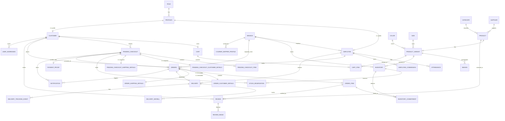
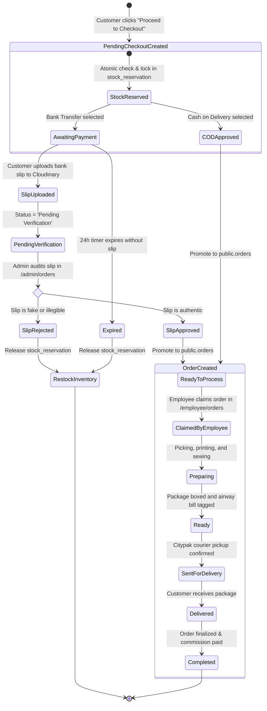

# Vergo Wear - Database & Cloudinary Storage Architecture
**Course:** Team Software Project (CSC304S3 / CSC304G3)  
**System:** Vergo Wear Custom Apparel & E-Commerce Platform  
**Document Version:** 1.0.0  
**Database Engine:** PostgreSQL 15+ (Hosted on Supabase) with Prisma ORM  
**Cloud Storage Provider:** Cloudinary Media CDN (SDK v2)  

---

## Table of Contents
1. [Architectural Overview](#1-architectural-overview)
2. [Complete Entity-Relationship (ER) Diagram](#2-complete-entity-relationship-er-diagram)
3. [Comprehensive Data Dictionary](#3-comprehensive-data-dictionary)
   - 3.1 Base Configuration & Core Lookups
   - 3.2 Identity, Profiles & Human Resources
   - 3.3 Apparel Product Catalogue & Color/Size Variant System
   - 3.4 Multi-Branch Inventory & Stock Commitment
   - 3.5 Shopping Cart & Active Sessions
   - 3.6 Two-Phase Pending Checkout & Stock Reservation Engine
   - 3.7 Payment Proof & Slip Storage
   - 3.8 Order Fulfillment & Milestone Lifecycles
   - 3.9 Delivery, Citypak Logistics & Waybill Tracking
   - 3.10 Customer Reviews & In-App / Multi-Channel Notifications
4. [The Two-Phase Checkout & Stock Lifecycle](#4-the-two-phase-checkout--stock-lifecycle)
5. [Cloudinary Media & Image Storage Architecture](#5-cloudinary-media--image-storage-architecture)
   - 5.1 Storage Integration Design & `CloudinaryService`
   - 5.2 Storage Bucket Hierarchy & File Namespaces
   - 5.3 Upload Pipeline: Multer Buffer Streaming
   - 5.4 Automatic Public ID Extraction & Asset Invalidation
   - 5.5 CDN Optimization, Transformations & Security Policies

---

## 1. Architectural Overview

The **Vergo Wear** data tier is engineered around two complementary cloud infrastructures:
1. **Supabase PostgreSQL 15+:** Serves as the relational operational database. It enforces relational integrity, check constraints, foreign keys, row-level security (RLS), and transactional consistency across 31 tables.
2. **Cloudinary Media Cloud (CDN):** Serves as the distributed media repository. High-resolution product apparel photography, color fabric swatches, verified customer review photos, and sensitive bank transfer deposit receipts are stored on Cloudinary. The database stores only the immutable CDN URLs and unique `storage_public_id` identifiers, keeping the relational database lean and performant.

---

## 2. Complete Entity-Relationship (ER) Diagram



---

## 3. Comprehensive Data Dictionary

### 3.1 Base Configuration & Core Lookups

#### `public.role`
Defines system authority levels for authentication.
- `role_id` (`uuid`, PK, Default: `gen_random_uuid()`): Unique role identifier.
- `role_name` (`text`, Unique, Not Null): Role identifier string (`'admin'`, `'employee'`, `'customer'`).

#### `public.branch`
Stores physical Vergo retail stores, showrooms, and warehouse fulfillment centers.
- `branch_id` (`uuid`, PK, Default: `gen_random_uuid()`): Unique branch identifier.
- `name` (`text`, Not Null): Branch title (e.g., "Colombo Flagship Showroom", "Kandy Production Hub").
- `address` (`text`, Not Null): Physical street address.
- `phone` (`text`, Not Null): Contact telephone line.

#### `public.category`
Apparel classifications for navigation and filtering.
- `category_id` (`uuid`, PK, Default: `gen_random_uuid()`): Unique category ID.
- `name` (`text`, Unique, Not Null): Name (e.g., "Hoodies", "Oversized Tees", "Joggers", "Accessories").
- `description` (`text`, Nullable): Promotional description.

#### `public.supplier`
Fabric mills and raw material textile vendors.
- `supplier_id` (`uuid`, PK, Default: `gen_random_uuid()`): Unique supplier ID.
- `name` (`text`, Not Null): Vendor company name.
- `phone`, `email` (`text`, Not Null, Email Unique): Vendor contact channels.
- `address` (`text`, Not Null): Factory address.
- `status` (`text`, Default: `'Active'`, Check: `'Active' | 'Inactive'`): Operational availability.
- `created_at`, `updated_at` (`timestamp with time zone`): Record timestamps.

#### `public.color`
Master palette of available garment dye fabrics and hex codes.
- `color_id` (`uuid`, PK, Default: `gen_random_uuid()`): Unique color identifier.
- `name` (`text`, Not Null): Commercial color name (e.g., "Jet Black", "Washed Olive", "Off-White").
- `hex_code` (`text`, Check: `^#[0-9A-Fa-f]{6}$`): Hexadecimal web color code for color swatch rendering.
- `display_order` (`integer`, Default: `0`): UI sorting order.
- `status` (`text`, Default: `'Active'`, Check: `'Active' | 'Inactive'`): Whether color is currently active.
- `image_url` (`text`, Nullable): Cloudinary URL pointing to a high-resolution fabric texture swatch.
- `created_at`, `updated_at` (`timestamp with time zone`).

#### `public.size`
Standardized apparel sizing specifications.
- `size_id` (`uuid`, PK, Default: `gen_random_uuid()`): Unique size identifier.
- `name` (`text`, Not Null): Size label (e.g., `"XS"`, `"S"`, `"M"`, `"L"`, `"XL"`, `"XXL"`).
- `display_order` (`integer`, Default: `0`): Sequential ordering index for size selector buttons.
- `status` (`text`, Default: `'Active'`, Check: `'Active' | 'Inactive'`).
- `created_at`, `updated_at` (`timestamp with time zone`).

---

### 3.2 Identity, Profiles & Human Resources

#### `public.profiles`
Primary identity extension bound 1:1 with Supabase Auth (`auth.users`).
- `id` (`uuid`, PK, FK ➔ `auth.users(id)`): Supabase Auth user UUID.
- `role_id` (`uuid`, Not Null, FK ➔ `public.role(role_id)`): Assigned role ID.
- `username` (`text`, Unique): Handle for login and reviews.
- `status` (`text`, Default: `'active'`): User lifecycle status (`'active'`, `'banned'`, `'suspended'`).
- `must_change_password` (`boolean`, Default: `false`): Enforces password reset for freshly provisioned employees.
- `last_seen_at`, `created_at` (`timestamp with time zone`).

#### `public.employee`
Personnel records for workshop craftsmen, tailors, packaging operators, and branch staff.
- `employee_id` (`uuid`, PK, Default: `gen_random_uuid()`): Unique staff record ID.
- `profile_id` (`uuid`, Unique, Not Null, FK ➔ `public.profiles(id)`): Identity binding.
- `branch_id` (`uuid`, FK ➔ `public.branch(branch_id)`): Assigned branch location.
- `first_name`, `last_name` (`text`, Not Null): Staff member names.
- `phone`, `address` (`text`): Employee contact details.
- `position` (`text`): Job designation (e.g., "Screen Print Specialist", "Master Tailor", "Dispatch Officer").
- `salary` (`numeric`, Check: `>= 0`): Base monthly salary.
- `hire_date` (`date`): Date of employment commencement.
- `availability_status` (`text`, Default: `'OFF_DUTY'`, Check: `'AVAILABLE' | 'BUSY' | 'OFF_DUTY'`): Live duty toggle.
- `commission_per_parcel` (`numeric`, Default: `0`, Check: `>= 0`): Fixed incentive paid per fulfilled order.
- `created_by_profile_id` (`uuid`, FK ➔ `public.profiles(id)`): Admin user who hired/provisioned this employee.

#### `public.customer`
Registered retail apparel shoppers.
- `customer_id` (`uuid`, PK, Default: `gen_random_uuid()`): Unique customer ID.
- `profile_id` (`uuid`, Unique, Not Null, FK ➔ `public.profiles(id)`): Profile association.
- `first_name`, `last_name` (`text`, Not Null): Customer legal name.
- `contact_phone` (`text`): Primary contact phone number.
- `contact_email` (`text`, Unique, Not Null): Billing/notification email address.
- `created_at` (`timestamp with time zone`).

#### `public.attendance`
Daily biometric / login attendance ledger for branch employees.
- `attendance_id` (`uuid`, PK, Default: `gen_random_uuid()`): Unique attendance record.
- `employee_id` (`uuid`, Not Null, FK ➔ `public.employee(employee_id)`): Staff member.
- `date` (`date`, Not Null): Shift date.
- `check_in`, `check_out` (`timestamp with time zone`): Clock-in and clock-out timestamps.
- `status` (`text`, Check: `'PRESENT' | 'LATE' | 'ABSENT' | 'LEAVE'`).

#### `public.employee_commission`
Financial incentive ledger logging bonuses accrued by floor staff for order packing.
- `commission_id` (`uuid`, PK, Default: `gen_random_uuid()`): Unique commission record.
- `employee_id` (`uuid`, Not Null, FK ➔ `public.employee(employee_id)`): Beneficiary employee.
- `order_id` (`uuid`, Unique, Not Null, FK ➔ `public.orders(order_id)`): Associated fulfilled order.
- `rate_used` (`numeric`, Not Null, Check: `>= 0`): Commission rate applied at time of fulfillment.
- `commission_amount` (`numeric`, Not Null, Check: `>= 0`): Calculated monetary payout.
- `status` (`text`, Default: `'Approved'`, Check: `'Approved' | 'Paid' | 'Cancelled'`).
- `created_at`, `paid_at` (`timestamp with time zone`).

---

### 3.3 Apparel Product Catalogue & Color/Size Variant System

#### `public.product`
Generic parent apparel model.
- `product_id` (`uuid`, PK, Default: `gen_random_uuid()`): Unique product identifier.
- `category_id` (`uuid`, FK ➔ `public.category(category_id)`): Apparel category.
- `supplier_id` (`uuid`, FK ➔ `public.supplier(supplier_id)`): Textile vendor.
- `name` (`text`, Not Null): Garment style title (e.g. "Vergo Acid Wash Vintage Hoodie").
- `description` (`text`): Fabric weight (GSM), blend composition, wash care instructions.
- `base_price` (`numeric`, Not Null, Check: `>= 0`): Baseline selling price.
- `status` (`text`, Default: `'hidden'`): Visibility toggle (`'active'`, `'hidden'`).
- `created_at` (`timestamp with time zone`).

#### `public.product_variant`
The specific physical Stock Keeping Unit (SKU) generated by combining a parent product with a color and size.
- `variant_id` (`uuid`, PK, Default: `gen_random_uuid()`): Unique variant identifier.
- `product_id` (`uuid`, Not Null, FK ➔ `public.product(product_id)`): Parent product model.
- `sku` (`text`, Unique, Not Null): Alphanumeric barcode identifier (e.g., `"VG-HD-BLK-XL"`).
- `color_id` (`uuid`, Not Null, FK ➔ `public.color(color_id)`): Fabric color swatch.
- `size_id` (`uuid`, Not Null, FK ➔ `public.size(size_id)`): Garment size.
- `price_adjustment` (`numeric`, Default: `0.00`, Check: `>= 0`): Additional price added to `base_price`.
- `status` (`text`, Default: `'show'`): Variant availability toggle.

#### `public.images`
Multi-angle apparel photos stored in Cloudinary and linked directly to individual variants.
- `id` (`bigint`, Identity PK): Sequential image record ID.
- `image_url` (`text`, Not Null): Secure Cloudinary CDN URL (`https://res.cloudinary.com/...`).
- `variant_id` (`uuid`, Not Null, FK ➔ `public.product_variant(variant_id)`): Associated variant.
- `created_at` (`timestamp without time zone`, Default: `now()`).

---

### 3.4 Multi-Branch Inventory & Stock Commitment

#### `public.inventory`
Tracks actual on-hand stock per variant at specific retail and warehouse locations.
- `inventory_id` (`uuid`, PK, Default: `gen_random_uuid()`): Unique inventory row.
- `variant_id` (`uuid`, Not Null, FK ➔ `public.product_variant(variant_id)`): Garment SKU.
- `branch_id` (`uuid`, FK ➔ `public.branch(branch_id)`): Physical location holding the stock.
- `quantity` (`integer`, Default: `0`, Check: `>= 0`): Immediately purchasable units on the shelf.
- `reorder_level` (`integer`, Default: `10`, Check: `>= 0`): Low stock threshold triggering restock warnings.
- `last_updated` (`timestamp with time zone`, Default: `now()`).
- `employee_id` (`uuid`, FK ➔ `public.employee(employee_id)`): Employee who last audited/adjusted this stock.

#### `public.inventory_commitment`
Tracks permanent inventory write-offs linked to finalized customer orders.
- `commitment_id` (`uuid`, PK, Default: `gen_random_uuid()`): Unique commitment record.
- `inventory_id` (`uuid`, Not Null, FK ➔ `public.inventory(inventory_id)`): Origin inventory item.
- `order_item_id` (`uuid`, Not Null, FK ➔ `public.order_item(order_item_id)`): Order item claiming the stock.
- `quantity` (`integer`, Not Null, Check: `> 0`): Units committed.
- `status` (`text`, Default: `'Committed'`, Check: `'Committed' | 'Restored'`): Current state.
- `committed_at`, `restored_at` (`timestamp with time zone`): Event timestamps.
- `restore_reason` (`text`, Nullable): Explanation if order is cancelled and items are returned to stock.

---

### 3.5 Shopping Cart & Active Sessions

#### `public.cart`
Persistent cart entity for registered customers.
- `cart_id` (`uuid`, PK, Default: `gen_random_uuid()`): Unique cart instance.
- `customer_id` (`uuid`, Not Null, FK ➔ `public.customer(customer_id)`): Cart owner.
- `created_at`, `updated_at` (`timestamp with time zone`).

#### `public.cart_item`
Individual apparel items placed inside a customer's cart.
- `cart_item_id` (`uuid`, PK, Default: `gen_random_uuid()`): Unique cart line item.
- `cart_id` (`uuid`, Not Null, FK ➔ `public.cart(cart_id)`): Parent cart.
- `variant_id` (`uuid`, Not Null, FK ➔ `public.product_variant(variant_id)`): Selected variant.
- `quantity` (`integer`, Default: `1`, Check: `> 0`): Selected units.

---

### 3.6 Two-Phase Pending Checkout & Stock Reservation Engine

#### `public.pending_checkout`
Staging area created when a user initiates checkout. Protects inventory while awaiting payment verification.
- `checkout_id` (`uuid`, PK, Default: `gen_random_uuid()`): Unique checkout session token.
- `customer_id` (`uuid`, Nullable, FK ➔ `public.customer(customer_id)`): Nullable for guest checkouts.
- `payment_method` (`text`, Not Null, Check: `'Bank Transfer' | 'Cash on Delivery'`): Chosen payment channel.
- `status` (`text`, Not Null, Check: `'Awaiting Payment' | 'Pending Confirmation' | 'Pending Verification' | 'Approved' | 'Rejected' | 'Cancelled' | 'Expired'`): Current workflow stage.
- `delivery_fee` (`numeric`, Not Null, Check: `>= 0`): District delivery fee calculated.
- `product_total`, `total_amount` (`numeric`, Not Null, Check: `>= 0`): Subtotal and final payable amounts.
- `expires_at` (`timestamp with time zone`): Deadline timestamp (24 hours for bank transfer slip uploads).
- `admin_notes` (`text`): Internal administrative moderation comments.
- `reviewed_by_profile_id` (`uuid`, FK ➔ `public.profiles(id)`): Admin user who reviewed this pending checkout.
- `reviewed_at`, `created_at`, `updated_at` (`timestamp with time zone`).

#### `public.pending_checkout_item`
Items locked inside a pending checkout.
- `checkout_item_id` (`uuid`, PK, Default: `gen_random_uuid()`).
- `checkout_id` (`uuid`, Not Null, FK ➔ `public.pending_checkout(checkout_id)`).
- `variant_id` (`uuid`, Not Null, FK ➔ `public.product_variant(variant_id)`).
- `quantity` (`integer`, Not Null, Check: `> 0`).
- `unit_price` (`numeric`, Not Null, Check: `>= 0`).

#### `public.pending_checkout_customer_details`
Snapshot of the buyer's contact info at the moment checkout is initiated.
- `detail_id` (`uuid`, PK, Default: `gen_random_uuid()`).
- `checkout_id` (`uuid`, Unique, Not Null, FK ➔ `public.pending_checkout(checkout_id)`).
- `first_name`, `last_name`, `email`, `phone` (`text`, Not Null).

#### `public.pending_checkout_shipping_details`
Snapshot of delivery address information for the pending checkout.
- `shipping_id` (`uuid`, PK, Default: `gen_random_uuid()`).
- `checkout_id` (`uuid`, Unique, Not Null, FK ➔ `public.pending_checkout(checkout_id)`).
- `receiver_name`, `phone`, `address_line_1`, `city`, `district` (`text`, Not Null).
- `address_line_2`, `postal_code`, `delivery_note` (`text`, Nullable).

#### `public.stock_reservation`
Atomic reservation lock holding stock in `public.inventory` during checkout.
- `reservation_id` (`uuid`, PK, Default: `gen_random_uuid()`): Unique reservation token.
- `inventory_id` (`uuid`, Not Null, FK ➔ `public.inventory(inventory_id)`): Specific branch inventory row.
- `checkout_id` (`uuid`, Not Null, FK ➔ `public.pending_checkout(checkout_id)`): Parent pending checkout.
- `quantity` (`integer`, Not Null, Check: `> 0`): Quantity locked against other buyers.
- `status` (`text`, Default: `'Active'`, Check: `'Active' | 'Pending Verification'`): State of lock.
- `expires_at`, `created_at` (`timestamp with time zone`).

---

### 3.7 Payment Proof & Slip Storage

#### `public.payment_proof`
Customer-uploaded bank deposit receipts and ATM transaction slips stored via Cloudinary.
- `payment_proof_id` (`uuid`, PK, Default: `gen_random_uuid()`): Unique proof identifier.
- `checkout_id` (`uuid`, Unique, Not Null, FK ➔ `public.pending_checkout(checkout_id)`): Associated pending checkout.
- `file_url` (`text`, Not Null): Secure Cloudinary CDN asset URL.
- `storage_public_id` (`text`): Cloudinary asset ID (e.g., `"payment_proofs/vg_slip_91024"`).
- `file_name` (`text`): Original filename uploaded by the user.
- `mime_type` (`text`): Content type (e.g. `'image/jpeg'`, `'image/png'`, `'application/pdf'`).
- `file_size_bytes` (`integer`, Check: `>= 0`): Size of the receipt file in bytes.
- `status` (`text`, Default: `'Pending Verification'`, Check: `'Pending Verification' | 'Approved' | 'Rejected' | 'Expired'`): Approval state.
- `reviewed_by_profile_id` (`uuid`, FK ➔ `public.profiles(id)`): Administrator who approved or rejected the slip.
- `rejection_reason` (`text`): Reason if rejected (e.g., "Account number does not match", "Blurry deposit slip").
- `uploaded_at`, `updated_at`, `reviewed_at` (`timestamp with time zone`).

---

### 3.8 Order Fulfillment & Milestone Lifecycles

#### `public.orders`
The authoritative verified order record created once payment is approved (or COD is placed).
- `order_id` (`uuid`, PK, Default: `gen_random_uuid()`): Unique order identifier.
- `customer_id` (`uuid`, FK ➔ `public.customer(customer_id)`): Ordering customer.
- `employee_id` (`uuid`, FK ➔ `public.employee(employee_id)`): Fulfillment employee who claimed the order.
- `branch_id` (`uuid`, FK ➔ `public.branch(branch_id)`): Branch fulfilling the items.
- `checkout_id` (`uuid`, Not Null, FK ➔ `public.pending_checkout(checkout_id)`): Originating checkout session.
- `total_amount`, `product_total`, `delivery_fee` (`numeric`, Not Null, Check: `>= 0`).
- `payment_method` (`text`, Not Null, Check: `'Bank Transfer' | 'Cash on Delivery'`).
- `order_status` (`text`, Default: `'Ready to Process'`, Not Null): Status milestones:
  - `'Ready to Process'` ➔ Verified and available for workshop staff to claim.
  - `'Claimed by Employee'` ➔ Claimed by a specific staff member.
  - `'Preparing'` ➔ Garment picked, printed, stitched, and ironed.
  - `'Ready'` ➔ Packaged and ready for courier pickup.
  - `'Sent for Delivery'` ➔ Handed over to courier with airway bill.
  - `'Delivered'` ➔ Confirmed receipt by buyer.
  - `'Completed'` ➔ Fully closed order.
  - `'Cancelled'` ➔ Voided order.
- **Milestone Timestamps:** `order_date`, `claimed_at`, `preparing_at`, `parcel_ready_at`, `sent_at`, `delivered_at`, `completed_at`, `updated_at`.

#### `public.order_item`
Final line items inside a confirmed order.
- `order_item_id` (`uuid`, PK, Default: `gen_random_uuid()`).
- `order_id` (`uuid`, Not Null, FK ➔ `public.orders(order_id)`).
- `variant_id` (`uuid`, Not Null, FK ➔ `public.product_variant(variant_id)`).
- `quantity` (`integer`, Not Null, Check: `> 0`).
- `unit_price`, `subtotal` (`numeric`, Not Null, Check: `>= 0`).

#### `public.order_customer_details` & `public.order_shipping_details`
Permanent immutable snapshot records tied 1:1 with `public.orders`. Guarantees order history remains intact even if customer updates their profile address book in the future.

---

### 3.9 Delivery, Citypak Logistics & Waybill Tracking

#### `public.delivery`
Logistics and dispatch record for each package.
- `delivery_id` (`uuid`, PK, Default: `gen_random_uuid()`): Unique delivery record.
- `order_id` (`uuid`, Unique, Not Null, FK ➔ `public.orders(order_id)`): Associated order.
- `courier_name` (`text`, Default: `'Citypak'`): Courier partner.
- `courier_reference`, `waybill_number` (`text`): Courier consignment numbers.
- `delivery_status` (`text`, Default: `'Pending'`, Check: `'Pending' | 'In Transit' | 'Delivered' | 'Failed' | 'Returned' | 'Cancelled'`).
- `submission_status` (`text`, Default: `'Pending'`, Check: `'Pending' | 'Submitted' | 'Failed' | 'Cancelled'`).
- `package_weight_grams` (`integer`), `number_of_pieces` (`integer`, Default: `1`).
- `package_length_cm`, `package_width_cm`, `package_height_cm` (`numeric`): Volumetric dimensions.
- `cod_amount` (`numeric`, Default: `0`): Cash to be collected upon delivery.
- `pod_image_url` (`text`): Proof of Delivery image captured by courier on delivery.
- `receiver_name`, `receiver_nic` (`text`): Details of person who received the parcel.
- `submitted_by_employee_id` (`uuid`, FK ➔ `public.employee(employee_id)`): Dispatching employee.
- `submitted_at`, `delivered_at`, `updated_at`, `last_tracking_sync_at` (`timestamp with time zone`).

#### `public.delivery_waybill` & `public.delivery_tracking_event`
- `delivery_waybill`: Stores tracking numbers and facility codes.
- `delivery_tracking_event`: Detailed milestone events logged automatically by Citypak tracking API webhooks (e.g., "Arrived at Central Sorting Hub", "Out for Delivery", "Delivered").

#### `public.delivery_fee_rules`
Configurable delivery fees per administrative district in Sri Lanka.
- `rule_id` (`uuid`, PK, Default: `gen_random_uuid()`).
- `district` (`text`, Unique, Not Null): District name (e.g. "Colombo", "Gampaha", "Kandy", "Jaffna").
- `base_delivery_fee` (`numeric`, Default: `400`): Base charge for packages up to base item limit.
- `base_item_limit` (`integer`, Default: `5`): Maximum items included under base fee.
- `additional_item_block_size` (`integer`, Default: `5`), `additional_block_fee` (`numeric`, Default: `140`): Incremental charges for bulky orders.
- `fuel_surcharge_percentage` (`numeric`, Default: `15`, Check: `0` to `100`): Surcharge calculation.
- `is_active` (`boolean`, Default: `true`).

---

### 3.10 Customer Reviews & In-App / Multi-Channel Notifications

#### `public.review` & `public.review_image`
Customer product ratings and testimonials.
- `review_id` (`uuid`, PK, Default: `gen_random_uuid()`).
- `product_id` (`uuid`, Not Null, FK ➔ `public.product(product_id)`).
- `customer_id` (`uuid`, Not Null, FK ➔ `public.customer(customer_id)`).
- `order_item_id` (`uuid`, Unique, Not Null, FK ➔ `public.order_item(order_item_id)`): **Strict Verified Purchase constraint** — reviews can only be submitted for completed order items.
- `rating` (`integer`, Check: `1` to `5`): Star rating.
- `comment` (`text`, Not Null): Customer review content.
- `is_hidden` (`boolean`, Default: `false`): Moderation flag.
- `review_image`: Stores customer-submitted photos of the garment worn in real life, hosted on Cloudinary (`image_url`).

#### `public.notification`
Multi-channel notification inbox for customers and staff.
- `notification_id` (`uuid`, PK, Default: `gen_random_uuid()`).
- `recipient_profile_id` (`uuid`, FK ➔ `public.profiles(id)`): Recipient user.
- `order_id` (`uuid`, FK ➔ `public.orders(order_id)`), `checkout_id` (`uuid`, FK ➔ `public.pending_checkout(checkout_id)`).
- `title`, `message` (`text`, Not Null): Notification text.
- `channel` (`text`, Default: `'IN_APP'`, Check: `'IN_APP' | 'EMAIL' | 'SMS'`).
- `status` (`text`, Default: `'Pending'`, Check: `'Pending' | 'Sent' | 'Failed'`).
- `is_read` (`boolean`, Default: `false`).
- `sent_at`, `created_at`, `updated_at` (`timestamp with time zone`).

---

## 4. The Two-Phase Checkout & Stock Lifecycle

The system utilizes an enterprise **Two-Phase Checkout and Stock Lock Pattern** to prevent overselling while supporting manual bank deposit receipts:



---

## 5. Cloudinary Media & Image Storage Architecture

### 5.1 Storage Integration Design & `CloudinaryService`

All media assets in Vergo Wear are processed through a centralized, reusable NestJS provider: `CloudinaryService` (located at `backend/src/cloudinary/cloudinary.service.ts`).

```
[Client Multipart Upload]
           │
           ▼
[NestJS FileInterceptor (Multer Buffer)]
           │
           ▼
[CloudinaryService.uploadBuffer()]
           │
           ├──> Streams buffer via cloudinary.v2.uploader.upload_stream
           ├──> Extracts secure_url and public_id
           └──> Persists only URL & public_id in PostgreSQL
```

The service is configured securely through environment variables:
```typescript
cloudinary.config({
  cloud_name: this.configService.get<string>('CLOUDINARY_CLOUD_NAME'),
  api_key: this.configService.get<string>('CLOUDINARY_API_KEY'),
  api_secret: this.configService.get<string>('CLOUDINARY_API_SECRET'),
  secure: true, // Enforces HTTPS for all delivery URLs
});
```

### 5.2 Storage Bucket Hierarchy & File Namespaces

Cloudinary media assets are strictly segregated into folders:

| Folder / Namespace | Table Reference | Purpose | File Formats | Access Policy |
| :--- | :--- | :--- | :--- | :--- |
| `products/variants/` | `public.images.image_url` | High-res apparel product photos (front, back, model view). | WEBP, JPG, PNG | Public CDN |
| `colors/swatches/` | `public.color.image_url` | High-resolution fabric texture and dye swatches. | WEBP, PNG | Public CDN |
| `payment_proofs/` | `public.payment_proof.file_url` | Customer bank deposit slips and ATM receipts. | WEBP, JPG, PNG, PDF | Restricted / Admin Audit |
| `reviews/` | `public.review_image.image_url` | Verified customer apparel photos worn in real life. | WEBP, JPG, PNG | Public CDN (after review approval) |
| `courier/pod/` | `public.delivery.pod_image_url` | Proof of Delivery receipt photos signed by customer. | WEBP, JPG | Internal Operations |

### 5.3 Upload Pipeline: Multer Buffer Streaming

Rather than writing temporary files to local server disk (which poses security and container scaling risks), uploads use in-memory stream pipelines:

```typescript
async uploadBuffer(
  buffer: Buffer,
  options: UploadApiOptions = {},
): Promise<UploadApiResponse> {
  return new Promise<UploadApiResponse>((resolve, reject) => {
    const stream = cloudinary.uploader.upload_stream(
      { resource_type: 'auto', ...options },
      (error, result) => {
        if (error || !result) {
          reject(new InternalServerErrorException(`Upload failed: ${error?.message}`));
          return;
        }
        resolve(result);
      },
    );
    stream.end(buffer);
  });
}
```

### 5.4 Automatic Public ID Extraction & Asset Invalidation

When customers replace an uploaded bank slip, or when administrators delete an obsolete product image, storage quota must not be wasted:
1. `extractPublicIdFromUrl(url)`: Robustly parses the Cloudinary asset URL, stripping dynamic transformations (`f_auto,q_auto,w_500`), protocol, host, and version markers (`v1788961916`) to isolate the true public ID.
2. `deleteAsset(publicId)`: Issues a delete command to Cloudinary with `invalidate: true`, immediately purging cached copies from global Edge CDN nodes.

### 5.5 CDN Optimization, Transformations & Security Policies

1. **Next-Gen WebP Formatting:** All images are served with automatic format negotiation (`f_auto`) delivering WebP or AVIF based on the client browser's capability, reducing bandwidth by 40-70%.
2. **Quality & Compression Optimization:** `q_auto:good` applies intelligent perceptual compression, maintaining crisp fabric details while reducing load times.
3. **Responsive Image Sizing:** Storefront requests leverage dynamic image width transformations (e.g. `w_800` for desktop gallery, `w_350` for mobile catalog grid), eliminating oversized file downloads.
4. **MIME-Type & Executable Blocking:** Cloudinary configurations reject SVG upload uploads with embedded scripts and block executable binaries (`.exe`, `.sh`, `.bat`) to eliminate stored XSS and malware vectors.
